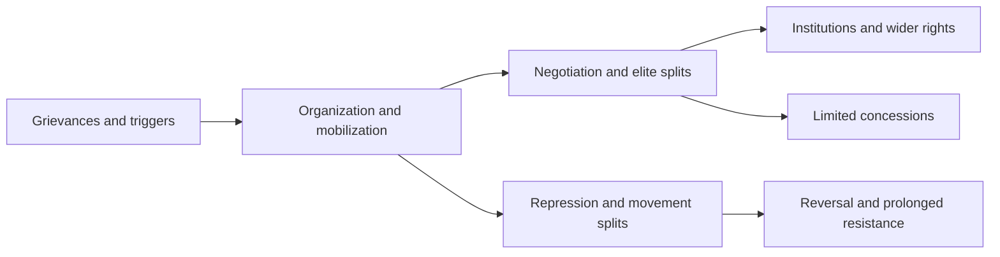
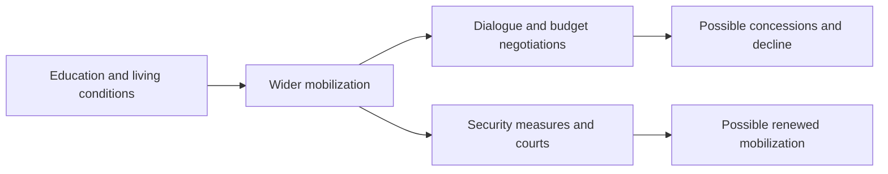

# Global Democratization: From the Streets to Institutions, and France Today

The history of democratization includes movements that challenged monarchies and military regimes to establish elections, movements that used existing constitutions to extend rights to excluded people, and movements that tried to restrain elected rulers. Removing a leader does not secure the freedoms participants sought if the military retains power or the new government represses its opponents.

Alongside the number of people in the streets, this report asks who gained the ability to constrain power and who gained access to voting, expression, and organization. Its country records cover the 193 UN member states plus the Holy See and Palestine, with Taiwan and Kosovo treated separately. The [country index and evidence notes](/en/reports/global-democracy-protest-history/sources/) contain national summaries, sources, and comparative limitations, while the [research log](/en/reports/global-democracy-protest-history/research/) explains selection and verification. This does not imply equally detailed research on every country.<SourceNote>[UN Library: Member States](https://research.un.org/en/unmembers/currentmembers), [Non-member observers](https://research.un.org/en/unmembers/observers)</SourceNote>

## Distinguishing democracy, democratization, and demonstrations

An assessment of democracy includes competitive elections, civil rights, laws and courts that constrain government, and political participation. International IDEA measures these through four categories: Representation, Rights, Rule of Law, and Participation. Democratization can be understood as the process of extending these protections, and democratic defense as maintaining or restoring existing protections.<SourceNote>[International IDEA: GSoD Technical Procedures Guide 2026](https://www.idea.int/publications/catalogue/html/global-state-democracy-indices-technical-procedures-guide-version-10)</SourceNote>

Demonstrations make demands visible. Participants may seek lower living costs, independence, religious rules, exclusionary policies, or rejection of election results. Neither a large turnout nor opposition to a government establishes that a movement promotes pluralism or equal political participation. Independence, republican government, multiparty politics, and democracy also require separate assessment.

| Movement or change | Outcome to examine |
| --- | --- |
| Policy protest | Did it change the policy in question? |
| Extension of rights | Who gained participation or protection? |
| Change of government | Did the leader or governing party change? |
| Democratization | Did competition, freedom, and constraints on power expand? |
| Democratic consolidation | Can losers compete again, and can transfers of power recur? |

Annual indices must also be distinguished from current events. V-Dem's 2026 report primarily assesses conditions at the end of 2025 and identifies 87 democracies and 92 autocracies under its Regimes of the World classification. Its 179 classified units cannot be replaced with this report's denominator of 195 countries. A publication dated 2026 does not necessarily assess protests in October.<SourceNote>[V-Dem: Democracy Report 2026, p.10](https://www.v-dem.net/documents/75/V-Dem_Institute_Democracy_Report_2026_lowres.pdf)</SourceNote>

## Six questions linking causes to outcomes

1. What grievances accumulated over time? Distinguish monopolized power, discrimination, colonial rule, corruption, inequality, and insecure employment.
2. What triggered protest? A death, electoral fraud, a price rise, a legislative change, or a coup is not the same as the underlying conditions.
3. Who organized? Did students, unions, religious organizations, parties, and local associations build shared demands and channels for negotiation?
4. How did the government, military, and police respond? Concessions and repression can coexist, and divisions within ruling elites also shape outcomes.
5. What changed immediately? Record policy withdrawal, a leader's departure, elections, detention, and the shift to war as distinct outcomes.
6. What lasted? Examine whether voting rights, judicial independence, civilian control, free association, and peaceful transfers of power endured.

The diagram shows how similar mobilization can lead to different outcomes, rather than a single sequence of development.

Comparative research on nonviolent resistance links outcomes to factors including diversity of participation and durable organization, while also finding that success rates declined in the 2010s. A single day's photographs cannot measure mobilization, and crossing a particular population threshold does not guarantee success. The causal accounts below are interpretations grounded in the context and evidence of each event, not universal formulas for success.<SourceNote>[Erica Chenoweth: The Future of Nonviolent Resistance](https://www.journalofdemocracy.org/articles/the-future-of-nonviolent-resistance-2/)</SourceNote>

## Broadening representation: from limits on royal power to universal suffrage

### Britain: parliamentary power and people's voting rights developed separately

The change of monarch in 1688–89 and the Bill of Rights restricted the monarch's powers to suspend laws and impose taxes, strengthening Parliament's position. This system grew out of religious conflict and struggles between the Crown and Parliament; it was not a democracy in which all inhabitants participated equally. The electoral reform of 1832 also retained property qualifications even as it expanded urban representation.<SourceNote>[House of Commons Library: the Bill of Rights](https://commonslibrary.parliament.uk/research-briefings/sn00293/), [UK Parliament: the 1832 reform](https://www.parliament.uk/about/living-heritage/evolutionofparliament/2015-parliament-in-the-making/get-involved1/2015-banners-exhibition/paula-stevens-hoare/the-great-reform-act-1832-gallery/)</SourceNote>

In response to that exclusion, the Chartists' People's Charter of 1838 demanded universal male suffrage, a secret ballot, and the abolition of property qualifications for members of Parliament, among other reforms. Parliament rejected their petitions at the time, but many of their demands later became law. Women's suffrage campaigners also pursued petitions, organizing, and direct action. The 1918 act set different qualifications for men and women; equal voting qualifications came in 1928. These movements show how campaigns rejected in the short term could leave issues on the agenda for institutional change.<SourceNote>[UK Parliament: the Chartist movement](https://www.parliament.uk/about/living-heritage/transformingsociety/electionsvoting/chartists/overview/chartistmovement/), [Women's suffrage](https://www.parliament.uk/about/living-heritage/transformingsociety/electionsvoting/womenvote/)</SourceNote>

### Women and Indigenous peoples: even early electoral systems excluded people

In New Zealand, organizing by Kate Sheppard and others, together with large-scale petition campaigns, led to women's right to vote in parliamentary elections in 1893. Women gained the right to stand for election at a different time. Australia's 1902 act also expanded women's participation in national politics but retained racial exclusions. The extension of federal voting rights to all Indigenous people came in 1962, a separate event from the constitutional amendment approved in the 1967 referendum. Focusing only on “the first year women could vote” obscures who remained excluded.<SourceNote>[NZHistory: women's suffrage](https://nzhistory.govt.nz/politics/womens-suffrage/brief-history), [National Museum of Australia: the 1902 act](https://www.nma.gov.au/defining-moments/resources/franchise-act), [Australian Electoral Commission: Indigenous voting rights](https://www.aec.gov.au/indigenous/milestones.htm)</SourceNote>

## The Americas: independence, emancipation, and transitions from military rule

### United States: excluded people reclaimed the founding ideals

The Declaration of Independence of 1776 and the Constitution of 1787 laid the foundations for government by the people, republicanism, and the separation of powers. Yet they coexisted with slavery, the exclusion of Indigenous peoples, women's lack of voting rights, and state-level property qualifications. The Constitution's Three-Fifths Clause did not grant enslaved people partial voting rights; it was a compromise that strengthened slaveholding states' political power by counting an enslaved population that could not vote when apportioning representation.<SourceNote>[National Archives: the making of the Constitution](https://www.archives.gov/founding-docs/constitution/how-did-it-happen), [Documented Rights](https://www.archives.gov/exhibits/documented-rights/exhibit/)</SourceNote>

During the Civil War and Reconstruction, enslaved people's escapes, military service, and organizing converged with abolitionism and federal legislation, and the Thirteenth through Fifteenth Amendments advanced the abolition of slavery, citizenship, equal protection under the law, and a ban on denying voting rights on racial grounds. But white supremacist violence, the retreat of federal protection, poll taxes, and literacy tests once again stripped Black people of political participation. This reversal left the constitutional text intact while making its rights unusable. The Nineteenth Amendment of 1920 also prohibited denial of voting rights on the basis of sex, but it did not remove racial barriers.<SourceNote>[Library of Congress: the history of Black voting](https://www.loc.gov/classroom-materials/elections/voters/african-americans/), [National Archives: the Nineteenth Amendment](https://www.archives.gov/milestone-documents/19th-amendment)</SourceNote>

In the civil rights movement of the 1950s and 1960s, Black churches, community organizations, women activists, and students combined boycotts, sit-ins, marches, and litigation. Mobilization in Montgomery, Birmingham, Washington, and Selma, and the public visibility of repression, fed into negotiations in Congress and pressure on the federal government. The Civil Rights Act of 1964 and the Voting Rights Act of 1965 translated demands from the streets into enforceable law. Neither a single hero nor a single day's march alone secured those laws.<SourceNote>[National Archives: SNCC](https://www.archives.gov/research/african-americans/black-power/sncc), [Selma](https://www.archives.gov/research/african-americans/vote/selma-marches), [Civil Rights Act](https://www.archives.gov/milestone-documents/civil-rights-act), [Voting Rights Act](https://www.archives.gov/milestone-documents/voting-rights-act)</SourceNote>

Inequalities in housing, wealth, and relations with the police persisted after the abolition of legal segregation. The mass Black Lives Matter mobilizations of 2020 followed the murder of George Floyd and demanded police accountability and racial equality. Many of the protests that ACLED recorded during a specified period were nonviolent, but individual incidents of looting or violence and police use of excessive force require separate examination. Changing the agenda and achieving uniform institutional improvements nationwide are different outcomes.<SourceNote>[ACLED: research on the summer 2020 protests](https://acleddata.com/report/demonstrations-and-political-violence-america-new-data-summer-2020)</SourceNote>

By contrast, the attack on the Capitol on January 6, 2021, obstructed certification of a valid election result. The House select committee situated the attack within a series of efforts to overturn the election result. Gathering in the streets or challenging institutions does not by itself make a movement one of democratization. The No Kings protests of 2025–26 voiced opposition to the concentration of power, among other objections, and rallies on October 17, 2026, called for participation in the coming elections. The November election results remained undetermined as of the research cutoff date, and crowd size does not provide a basis for predicting winners and losers.<SourceNote>[United States Congress: January 6 committee final report](https://www.govinfo.gov/collection/january-6th-committee-final-report), [AP: October 17, 2026](https://apnews.com/article/02d78e3dc4f1f75f8f8a5c327ba79008)</SourceNote>

### Haiti and Mexico: institutional problems after emancipation and social revolution

In Haiti, an uprising of enslaved people that began in 1791 led, through war against colonial rule, to independence in 1804. This turning point in world history confronted slaveholding society itself with the universality of freedom and equality. Yet the abolition of slavery and independence did not establish a stable, competitive parliamentary system. The indemnity France imposed in 1825, international isolation, and domestic power struggles also constrained state formation. The collapse of the Duvalier regime in 1986, Aristide's election in 1990, and the coup the following year belonged to a further, distinct process of democratization.<SourceNote>[Smithsonian: revolution and democracy](https://www.americanhistory.si.edu/explore/exhibitions/american-democracy/online/great-leap/great-debates/revolutionary-world), [Congressional Research Service: Haiti's democratization history](https://www.everycrsreport.com/reports/93-931.html)</SourceNote>

Mexico's revolution of 1910 involved different forces struggling over Díaz's prolonged rule and reelection, land, and labor. The Constitution of 1917 incorporated social rights, but the long period of ruling-party dominance that followed restricted equal political competition. After the repression of the student movement at Tlatelolco in 1968 and distrust of the 1988 election, accumulated electoral reforms and monitoring made the transfer of power in 2000 possible. Revolution, social rights, and competitive elections did not all reach fulfillment at the same time.<SourceNote>[Mexico's electoral institute: the history of democracy](https://farodemocratico.ine.mx/la-democracia-en-mexico/?mode=grid), [National Security Archive: documents from 1968](https://nsarchive2.gwu.edu/NSAEBB/NSAEBB10/intro.htm)</SourceNote>

### Brazil, Argentina, and Chile: different paths out of military rule

Brazil's Diretas Já campaign of 1984 united workers, students, opposition parties, and citizens in demanding direct presidential elections. Although Congress did not pass the constitutional amendment that would have introduced direct elections at once, the campaign weakened the legitimacy of military rule and generated pressure that contributed to the civilian transition in 1985, the Constitution of 1988, and direct elections in 1989. The defeat in a single vote can be distinguished from the campaign's long-term political effects.<SourceNote>[Brazilian Chamber of Deputies: Diretas Já](https://www.camara.leg.br/noticias/143271-decada-de-80-as-diretas-ja/), [Federal Senate: constitutional history](https://www.senado.leg.br/noticias/especiais/constituicao25anos/historia-das-constituicoes.htm)</SourceNote>

In Argentina, the Mothers of the Plaza de Mayo and others continued to demand the whereabouts of their relatives and state accountability for the disappearances and torture carried out by the military regime from 1976 onward. Economic crisis, the labor movement, and defeat in the 1982 war also weakened military rule, and an elected civilian government took office in 1983. Truth-seeking and trials after democratization were important achievements, but efforts to address impunity suffered reversals and later resumed, making accountability for state violence a long-term issue after elections returned.<SourceNote>[Argentine government: the Mothers' marches](https://www.argentina.gob.ar/noticias/44-anos-de-la-primera-ronda-de-madres-de-plaza-de-mayo), [The 1983 election](https://www.argentina.gob.ar/dine/elecciones-1983), [Library of Congress of Argentina: forty years of democracy](https://bcn.gob.ar/muestras-virtuales/audioguia-40-hitos-en-40-anos-de-democracia)</SourceNote>

In Chile, resistance and organizing by trade unions, civil society, and political parties contributed to the rejection of Pinochet's continued rule in the 1988 referendum and the civilian transition in 1990. The former regime's constitution and military influence persisted after the transition. In 2019, protests triggered by metro fares brought together grievances over pensions, inequality, and social protection, but voters rejected proposed new constitutions in both 2022 and 2023. The protests' opening of a constitutional agenda and voters' approval or rejection of a particular draft are separate outcomes.<SourceNote>[Chilean government: 2024 core document submitted to the United Nations](https://documents.un.org/access.nsf/get?DS=HRI%2FCORE%2FCHL%2F2024&Lang=E&OpenAgent=), [AP: the 2023 referendum](https://apnews.com/article/f7be231ff564856f6a5e1b0c0ac12c57)</SourceNote>

A United States-backed coup in 1954 cut short Guatemala's democratic opening of 1944, and Indigenous Maya suffered devastating harm in the civil war that followed. Concentrations of power over the judiciary and politics persisted after the Constitution of 1985 and the peace settlement of 1996. The mobilization of Indigenous organizations and others in 2023–24 to defend Arévalo's election victory and inauguration can be understood as a defense of democracy that helped translate an existing electoral result into an effective transfer of power.<SourceNote>[Inter-American Commission on Human Rights: Guatemala, 2025](https://www.oas.org/en/iachr/reports/pdfs/2025/informe_guatemala_en.pdf)</SourceNote>

## Asia: military vetoes, electoral fairness, and social equality

### China and Tiananmen: hopes for reform ended in a military crackdown

In China in 1989, anger at rising prices, corruption, and privilege associated with economic reform converged with hopes for greater political participation and freedom of expression. Hu Yaobang's death and commemorations in April prompted student gatherings that spread beyond Beijing to other cities, drawing workers and other citizens as well. Students, workers, and reformist intellectuals did not, however, share identical demands or organizations.<SourceNote>[National Security Archive: official documents on Tiananmen](https://nsarchive2.gwu.edu/NSAEBB/NSAEBB16/), [Amnesty International: a record of 1989](https://www.amnesty.org/en/projects/the-1989-tiananmen-crackdown/)</SourceNote>

After divisions within the leadership over dialogue and reform, the authorities imposed martial law and deployed troops, and from the night of June 3 into June 4 the military killed and wounded civilians in Beijing and suppressed the protests. Casualties occurred not only inside the square but also on surrounding roads and elsewhere, and restrictions on independent investigation prevent a definitive total death toll. Detention, punishment, and censorship denied the movement the possibility of continuing in public.<SourceNote>[National Security Archive: documents from June 1989](https://nsarchive2.gwu.edu/NSAEBB/NSAEBB16/)</SourceNote>

The short-term result was a retreat from political opening. Subsequent marketization and growth cannot be equated with an expansion of competitive elections or constraints on power. In comparative terms, Tiananmen shows that the scale of mobilization or economic development alone cannot overcome the military's loyalty and the ruling elite's choices. Nor did the suppression of the street movement extinguish the longer-term activities of exiles, those preserving its memory, and bereaved families seeking accountability.<SourceNote>[Amnesty International: Tiananmen, memory, and accountability](https://www.amnesty.org/en/projects/the-1989-tiananmen-crackdown/)</SourceNote>

### Myanmar: repeated resistance to military rule, not a change of president

In 1988, a nationwide uprising erupted against economic stagnation, losses from the invalidation of banknotes, and violence against students. The military suppressed it through killings, injuries, and arrests, and refused to transfer power even after the NLD won the 1990 election. The Saffron Revolution of 2007 spread from fuel-price increases, and violence against monks strengthened cooperation between religious figures and citizens, but the military government crushed the movement through monastery raids, gunfire, and detention. The two movements had different triggers and organizations.<SourceNote>[BTI: Myanmar's institutional history](https://bti-project.org/en/reports/country-report/MMR), [United Nations: the 2007 special report](https://digitallibrary.un.org/record/613501/files/A_HRC_6_14-EN.pdf)</SourceNote>

The partial opening from 2011 expanded the space for political activity and elections, but the Constitution of 2008 reserved one-quarter of parliamentary seats and key security powers for the military. The exclusion and persecution of the Rohingya also continued, so the freedoms of an electoral majority alone cannot measure democratization. Those the military detained in the coup of February 1, 2021, included President Win Myint and State Counsellor Aung San Suu Kyi. Suu Kyi was not the president.<SourceNote>[Freedom House: Myanmar, 2026 edition](https://freedomhouse.org/country/myanmar/freedom-world/2026), [United Nations Special Rapporteur: 2021 report](https://www.ohchr.org/en/HRBodies/HRC/RegularSessions/Session46/Documents/A_HRC_46_56.pdf)</SourceNote>

As military violence continued, the civil disobedience movement and street protests by health professionals, civil servants, workers, and others also became connected with some armed resistance. Nonviolent participants, the People's Defence Forces, and ethnic armed organizations that had been fighting for years had different objectives and chains of command and cannot be described as “the same protesters.” The military-led elections of late 2025 and early 2026 and Min Aung Hlaing's inauguration as president in April likewise cannot be assessed as a transition to free, inclusive choice. A change of office must be distinguished from the establishment of institutions that allow civilians to control the military.<SourceNote>[OHCHR: annual update for 2025, published in February 2026](https://bangkok.ohchr.org/sites/default/files/documents/2026-02/ohchr_myanmar_annual_update_2025.pdf), [AP: January 25, 2026](https://apnews.com/article/48f9f80748a23ce4ac9d7a1ea476f1f4), [AP: April 10, 2026](https://apnews.com/article/fca4366fed164acd0fb86d7f13891bc9)</SourceNote>

### Iran: constitutional revolution, the overthrow of monarchy, and movements for electoral and bodily freedom

In the Constitutional Revolution of 1906, merchants, religious figures, intellectuals, and local associations sought parliamentary and legal limits on royal power in response to arbitrary rule and foreign influence. The Constitution of 1906 and its 1907 Supplement were achievements of that movement, but royalist attacks, foreign intervention, and fiscal difficulties weakened the institutions. In 1953, Prime Minister Mosaddegh, who had pursued oil nationalization, was overthrown in a coup involving the United States and Britain and the actions of domestic forces. He was a prime minister within a parliamentary political system, not a directly elected president.<SourceNote>[Encyclopaedia Iranica: the Constitutional Revolution](https://www.iranicaonline.org/articles/constitutional-revolution/), [United States Department of State, FRUS: document of October 8, 1953](https://history.state.gov/historicaldocuments/frus1951-54IranEd2/d328)</SourceNote>

In the revolution of 1979, religious forces, liberals, leftists, students, merchants, and workers united to overthrow the monarchy in response to the shah's repression, rapid social change and inequality, and the closure of political participation. Commemorative gatherings and strikes shook the regime, but after the revolution Khomeini and religious institutions consolidated power and excluded their rivals. The resulting system combined elections with the unelected authority of the Supreme Leader and the Guardian Council. A coalition to overthrow a common enemy did not imply agreement on pluralist institutions afterward.<SourceNote>[BTI: Iran's transition history and institutions](https://bti-project.org/en/reports/country-report/IRN)</SourceNote>

The Green Movement of 2009 sought accountability primarily over distrust of the presidential election, while “Woman, Life, Freedom” in 2022 arose after the death of Jina (Mahsa) Amini following her detention and brought compulsory dress rules, dignity, discrimination, and the governing system into question. Street actions and everyday disobedience by women, young people, ethnic minorities, and others expressed demands for rights that cannot be reduced to the counting of votes. The United Nations fact-finding mission has established killings, torture, sexual violence, and other violations. The mission's legal assessments must be distinguished from final judgments on individuals' criminal responsibility.<SourceNote>[Freedom House: Iran, 2026 edition](https://freedomhouse.org/country/iran/freedom-world/2026), [United Nations fact-finding mission: September 2024 update](https://www.ohchr.org/sites/default/files/documents/hrbodies/hrcouncil/ffmi-iran/FFM-Iran-Update-13-September-2024.pdf)</SourceNote>

In late 2025 and early 2026, protests spread from a currency and price crisis, amid reports of large-scale killings and injuries inflicted by the authorities and restrictions on communications. The United Nations Human Rights Council decided to continue the investigation. The repression of protests, subsequent foreign military action, and leadership succession within the regime are separate processes, none of which should be reinterpreted as the fulfillment of citizens' demands for democratization.<SourceNote>[HRW: investigation of January 16, 2026](https://www.hrw.org/news/2026/01/16/iran-growing-evidence-of-countrywide-massacres), [United Nations: Human Rights Council meeting of January 23](https://www.ungeneva.org/es/news-media/meeting-summary/2026/01/human-rights-council-adopts-resolution-extending-mandates-fact), [AP: the March 2026 succession](https://apnews.com/article/f0b20dbffaea9351ae1e54183ffe53ff)</SourceNote>

### Malaysia: changing the terms of competition within a system that held elections

The immediate triggers of Reformasi in 1998 were the conflict between Mahathir and Anwar during the financial crisis and Anwar's dismissal and detention. Young people, civic groups, opposition parties, and others criticized corruption, the political use of the judiciary and police, and authoritarianism. Although they could not immediately remove the ruling party, they laid the foundations for later opposition cooperation and civic organizing.<SourceNote>[ISEAS: changes in the political order](https://www.iseas.edu.sg/wp-content/uploads/2021/12/ISEAS_Perspective_2022_2.pdf)</SourceNote>

Through mass rallies and election monitoring from 2007 onward, Bersih contested the conditions of entry into political competition, including electoral rolls, electoral rules, and access to the media. Cooperation among citizens across ethnic lines developed into an organized force challenging electoral politics long dominated by the ruling party. The first change of federal government in 2018 reflected this accumulated work, along with the 1MDB scandal, grievances over the cost of living, and divisions within the ruling elite. A single demonstration did not bring down the government.<SourceNote>[ISEAS: Bersih's long-term impact](https://www.iseas.edu.sg/articles-commentaries/iseas-perspective/2021-167-the-profound-impact-of-the-bersih-movement-since-2007-by-khoo-boo-teik/)</SourceNote>

The government's collapse through coalition realignment in 2020 and the unity government formed after the 2022 election showed that institutional reform remained unstable even after alternation in power became possible. The victory of forces campaigning for reform, the establishment of fair elections, and the protection of the judiciary and freedom of expression are distinct achievements.<SourceNote>[Freedom House: Malaysia, 2026 edition](https://freedomhouse.org/country/malaysia/freedom-world/2026)</SourceNote>

### South Korea and Taiwan: Turning the Legacy of Repression into Changes to the Rules of Political Competition

South Korea's April Revolution of 1960 forced Syngman Rhee from office in response to electoral fraud and police violence, but a military coup the following year reversed the democratic opening. In Gwangju in 1980, the military crushed citizens' protests and resistance against military violence. Despite this immediate defeat, victims' families, civic organizations, and religious figures continued to document events and organize, sustaining the legitimacy of democratization. In 1987, students, workers, office employees, churches, and opposition parties expanded their mobilization against a death under torture and its cover-up, and against the refusal to amend the constitution, prompting the government to accept direct presidential elections.<SourceNote>[UNESCO, Archives of the April 19 Revolution](https://www.unesco.org/en/memory-world/archives-april-19-revolution), [Gwangju archives](https://www.unesco.org/en/memory-world/human-rights-documentary-heritage-1980-archives-may-18th-democratic-uprising-against-military-regime), [Korea Democracy Foundation, 1987](https://archives.kdemo.or.kr/display/en/move610.html)</SourceNote>

Roh Tae-woo, who represented the former military regime, won that year's election. The achievement lay in changing the rules to make alternation in power possible, rather than transferring power to the opposition at once. The candlelight rallies of 2016–17 fed into parliamentary impeachment and the Constitutional Court's removal of Park Geun-hye from office. Parliament and citizens also resisted the declaration of martial law in late 2024, and the Constitutional Court removed Yoon Suk Yeol from office in April 2025. The number of people on the streets did not substitute for a judicial ruling; citizens' actions and constitutional procedures constrained power.<SourceNote>[BTI, South Korea's institutional history](https://bti-project.org/en/reports/country-report/KOR), [Constitutional Court of Korea, April 4, 2025](https://english.ccourt.go.kr/site/kor/ex/bbs/View.do?bcIdx=4243079&cbIdx=1127)</SourceNote>

In Taiwan, political activity continued through local elections, the tangwai opposition movement, and the families and defense lawyers of defendants, even under the White Terror and prolonged martial law. The crackdown in the 1979 Kaohsiung Incident, the formation of the Democratic Progressive Party in 1986, the lifting of martial law in 1987, the Wild Lily student movement of 1990, the direct presidential election of 1996, and the transfer of power in 2000 each marked a distinct turning point. An explanation needs to consider citizens' pressure, economic and social changes, and decisions to pursue reform within the Kuomintang together.<SourceNote>[BTI, Taiwan's institutional history](https://bti-project.org/en/reports/country-report/TWN), [Japan's Ministry of Foreign Affairs, Taiwan facts and chronology](https://www.mofa.go.jp/mofaj/area/taiwan/data.html), [Swarthmore, the Wild Lily Movement](https://nvdatabase.swarthmore.edu/content/taiwanese-student-sit-democratic-reform-wild-lily-movement-1990)</SourceNote>

After democratization, the Sunflower Movement of 2014 challenged the deliberation process and oversight of the services trade agreement with China. Demands to end dictatorship can be distinguished from demands for transparent decision-making within a democracy. Taiwan's experience calls for comparing how ruling elites, organizations, and institutional reforms interacted, rather than using it to argue that particular cultures are "suited" or "unsuited" to democracy.<SourceNote>[Freedom House, Taiwan 2026](https://freedomhouse.org/country/taiwan/freedom-world/2026)</SourceNote>

### The Philippines and Indonesia: Mass Mobilization and Defections from the Ruling Elite

In the Philippines, the assassination of Benigno Aquino in 1983 and electoral fraud in 1986 compounded discontent with Marcos's concentration of power, crony capitalism, and the economic crisis. Opposition unity, appeals through churches and broadcasting, and citizens' nonviolent action combined with defections by senior military officers and a change in United States support, and the EDSA People Power movement forced Marcos from office. The 1987 Constitution rebuilt protections for rights and the separation of powers, but concentrated ownership of land and wealth, political dynasties, and military influence persisted. A few days in the capital cannot explain this long history of resistance.<SourceNote>[A documented chronology of EDSA](https://www.gmanetwork.com/news/topstories/specialreports/600884/a-timeline-of-the-1986-edsa-people-power-revolution/story/), [Official Gazette of the Philippines, constitution-making](https://officialgazette.gov.ph/constitutions/constitution-day/), [BTI, the Philippines](https://bti-project.org/en/reports/country-report/PHL)</SourceNote>

In Indonesia, the financial crisis of 1997 deepened problems involving prices, employment, banks, and politically connected businesses, eroding support for Suharto's regime. The shooting of students in May 1998, nationwide student mobilization, the occupation of parliament, and defections by ministers and parliamentary leaders culminated in Suharto's resignation on May 21. The killings, looting, and sexual violence against ethnic Chinese people during the same period must not be treated as legitimate means of democratization or as necessary sacrifices.<SourceNote>[IMF Independent Evaluation Office, the financial crisis](https://www.imf.org/external/np/ieo/2003/cac/pdf/all.pdf), [HRW, the student movement](https://www.hrw.org/report/1998/08/01/academic-freedom-indonesia/dismantling-soeharto-era-barriers), [Violence against ethnic Chinese women](https://www.hrw.org/legacy/reports/reports98/indonesia3/violence.htm)</SourceNote>

The 1999 election, decentralization, constitutional amendments, and the direct presidential election of 2004 translated his departure into institutional change. However, established economic elites adapted to the new institutions, while corruption, military involvement, minority rights, and accountability for past violence remained unresolved. Both countries require separate assessments of "the capacity to remove a leader" and "the capacity to disperse power afterward."<SourceNote>[BTI, Indonesia](https://bti-project.org/en/reports/country-report/IDN)</SourceNote>

### India, Bangladesh, and Nepal: Independence and Inclusive Institutions Are Distinct Challenges

India's independence movement included Gandhi and the Indian National Congress alongside peasants, workers, women, Muslim organizations, and movements of people facing discrimination led by figures such as Ambedkar; these participants held different visions for the post-independence order. Noncooperation, boycotts, and the Salt March connected everyday demands to sovereignty, but independence in 1947 brought partition, large-scale violence, and displacement. The 1950 Constitution and the 1951–52 general election established universal suffrage without using poverty or literacy as grounds to restrict voting rights, a significant institutional choice. Political equality alone did not eliminate inequalities of caste, land, or gender.<SourceNote>[Stanford, Gandhi scholarship](https://kinginstitute.stanford.edu/gandhi-mohandas-k), [The National Archives of the United Kingdom, partition](https://www.nationalarchives.gov.uk/education/teaching-resources/partition-of-british-india/), [Election Commission of India, the history of universal suffrage](https://www.eci.gov.in/EBooks/Leap-of-Faith/files/basic-html/page34.html)</SourceNote>

In 1975, amid economic discontent, antigovernment mobilization, and a court ruling concerning the prime minister's election, Indira Gandhi's government declared an emergency and imposed censorship and the detention of opposition figures. Holding an election in 1977 and the ruling party's acceptance of defeat made the restoration of liberties possible. The subsequent Forty-fourth Amendment to the Constitution placed limits on emergency powers. This case demonstrates both democratic backsliding under an elected leader and repair through elections.<SourceNote>[TIME's review based on contemporary reporting](https://time.com/3935184/indira-gandhi-emergency-40-years-1975/), [Government of India, records of the Emergency and constitutional amendment](https://www.pib.gov.in/FactsheetDetails.aspx?Id=149224&lang=1&reg=48)</SourceNote>

Bangladesh's independence in 1971 followed repression and war arising from regional and linguistic discrimination against East Pakistan and the refusal to transfer power to the Awami League after it won a majority in the 1970 election. The country subsequently experienced one-party and military rule, and the antimilitary movement of 1990 led to the restoration of parliamentary government. In 2024, student protests over quotas in civil-service recruitment expanded into an antigovernment movement amid anger at killings and injuries inflicted by security forces and others, culminating in Hasina's departure. The government's own violence turned demands over everyday unfairness into a challenge to the legitimacy of its rule.<SourceNote>[National Security Archive, 1971](https://nsarchive2.gwu.edu/NSAEBB/NSAEBB79/), [BTI, Bangladesh](https://bti-project.org/en/reports/country-report/BGD), [OHCHR, fact-finding investigation into the 2024 protests](https://www.ohchr.org/sites/default/files/documents/countries/bangladesh/ohchr-fftb-hr-violations-bd.pdf)</SourceNote>

Even after interim rule gave way to elections and the inauguration of a new prime minister in February 2026, attacks on minorities, reprisals, exclusion of the former ruling party, and partisanship in the police and judiciary require separate assessment. A transition that protects only the winners' rights risks repeating earlier forms of exclusion.<SourceNote>[AP, February 17, 2026](https://apnews.com/article/fbc4222e01bbc5aa7ac120801218ef24), [OHCHR fact-finding report](https://www.ohchr.org/sites/default/files/documents/countries/bangladesh/ohchr-fftb-hr-violations-bd.pdf)</SourceNote>

In Nepal, the People's Movement of 1990 transformed a king-centered system into a constitutional monarchy and multiparty system, but social exclusion and poverty persisted, and the Maoists waged an armed struggle from 1996. In response to the king's imposition of direct rule in 2005, the major political parties and the Maoists drew closer, and citizens' protests and strikes in 2006 prompted the restoration of parliament. Nepal proceeded through the Comprehensive Peace Agreement that year, a constituent assembly, the establishment of a republic in 2008, and a federal constitution in 2015. The transition connected street mobilization, political agreement with an adversary, the end of war, and constitution-making, while accountability for past abuses and inclusive representation remained unresolved.<SourceNote>[Swarthmore, the People's Movement of 1990](https://nvdatabase.swarthmore.edu/content/nepalese-force-king-accept-democratic-reform-jana-andolan-peoples-movement-1990), [OHCHR, investigation into the 2006 protests](https://nepal.ohchr.org/en/resources/Documents/English/statements/HCR/Year2006/2006_09_21_HCR_DJ.pdf), [Comprehensive Peace Agreement](https://peacemaker.un.org/sites/default/files/document/files/2024/05/np061122comprehensive20peace20agreement20between20the20government20and20the20cpn2028maoist29.pdf)</SourceNote>

Japan's history likewise requires distinguishing the Freedom and People's Rights Movement, party politics in the Taishō era and universal male suffrage in 1925, repression under militarism, and reforms following defeat and under occupation. Women first voted in a general election in 1946, and the 1947 Constitution institutionalized popular sovereignty and fundamental human rights. The 1960 movement against the security treaty helped force Prime Minister Kishi's resignation but did not prevent the revised treaty from taking effect. Separating the external condition of occupation from domestic movements and the roles of legislation and elections clarifies the distinction between democratization and policy protests within a democracy.<SourceNote>[National Diet Library, The Birth of the Constitution of Japan](https://www.ndl.go.jp/constitution/), [National Diet Library, suffrage and the Peace Preservation Law in 1925](https://www.ndl.go.jp/modern/cha3/description13.html), [Nick Kapur's study of the 1960 security treaty protests](https://apjjf.org/2020/18/Kapur)</SourceNote>

## Africa: Racial Liberation, National Conferences, and Military Power after Revolution

### South Africa: Securing Political Equality through Negotiation and a Constitution

Apartheid restricted voting, landholding, residence, education, and movement according to race. The Defiance Campaign of 1952, the Freedom Charter of 1955, Sharpeville in 1960, and Soweto in 1976 mobilized different generations and organizations. The activities of the UDF, trade unions, churches, and community organizations expanded during the 1980s. This history, in which nonviolent movements, underground activity, armed struggle, and state violence coexisted, cannot be reduced to a single tactic or leader.<SourceNote>[South African History Online, the Freedom Charter](https://sahistory.org.za/article/background-freedom-charter-1955), [Turning points in 1960, 1976, and 1990](https://sahistory.org.za/classroom/grade-9/turning-points-1960-1976-and-1990)</SourceNote>

Domestic protests and difficulties in governing, sanctions and economic costs, the difficulty of achieving a military resolution, and the end of the Cold War changed the conditions for negotiation. Violence and breakdowns in negotiations continued after the legalization of liberation organizations and Mandela's release in 1990. The institutional significance lay in combining interim power-sharing with suffrage for people of all races and proceeding to the 1994 election and the 1996 Constitution. The Bill of Rights and the judiciary constrained even a government that had won majority support.<SourceNote>[Nelson Mandela Foundation, negotiations in 1985–94](https://www.nelsonmandela.org/talking-to-the-enemy-1985-to-1994), [South African Department of Justice, the Constitution](https://www.justice.gov.za/constitution/basicprov.html)</SourceNote>

Guarantees of political equality did not erase racialized inequalities in assets, employment, and residence. The ANC's loss of its parliamentary majority in 2024 also shows that the legitimacy of a liberation movement and voters' present judgments are not the same. The achievements of democratization can coexist with criticism of living conditions, corruption, and public services.<SourceNote>[Freedom House, South Africa 2026](https://freedomhouse.org/country/south-africa/freedom-world/2026)</SourceNote>

### Benin and Ghana: Turning Transition Agreements into Institutions That Accept Defeat

In Benin, civil servants, students, teachers, and others protested the fiscal crisis of the one-party system and unpaid wages. The National Conference of 1990 went beyond consultation to assert sovereign authority and proceed toward interim institutions and a constitution. Kérékou's acceptance of electoral defeat in 1991 turned negotiations into an actual transfer of power. Other Francophone countries drew on this example, but the conference format alone could not guarantee the same results. Subsequent restrictions on competition through electoral rules and the judiciary also show the fragility of an initial success.<SourceNote>[Gisselquist's study of Benin's transition](https://research.birmingham.ac.uk/en/publications/democratic-transition-and-democratic-survival-in-benin/), [Freedom House, Benin 2026](https://freedomhouse.org/country/benin/freedom-world/2026)</SourceNote>

In Ghana, the military regime managed an opening in response to domestic demands for democratization, proceeding to the 1992 Constitution and multiparty elections. The incumbents initially held an advantage, and opposition distrust remained strong. Through the cumulative work of electoral administration, the press, civil society, and competition between parties, the 2000 election and the inauguration the following year brought the opposition to power. The country moved from holding elections to maintaining the rules even when incumbents lost.<SourceNote>[Stanford CDDRL, a study of Ghana's transition](https://cddrl.fsi.stanford.edu/publications/the_world_bank_made_me_do_it_international_factors_and_ghanas_transition_to_democracy), [Freedom House, a historical assessment](https://www.refworld.org/reference/countryrep/freehou/2008/63832)</SourceNote>

### The Arab Spring: Tunisia and Egypt Diverged within the Same Wave

In Tunisia, regional inequalities, unemployment, corruption, and arbitrary police treatment had accumulated, and Bouazizi's self-immolation in December 2010 triggered expanding protests. Young people in the provinces, trade unions, lawyers, and human rights activists sustained the mobilization, and Ben Ali left power in January 2011. Social media alone did not create the movement. During the crisis of assassinations and political conflict in 2013, the National Dialogue Quartet of trade unions, employers, a human rights organization, and the bar association brokered compromise and supported the 2014 Constitution and elections.<SourceNote>[HRW, a record of Tunisia in 2011](https://www.hrw.org/world-report/2012/country-chapters/tunisia), [The Nobel Committee, the National Dialogue Quartet](https://www.nobelprize.org/prizes/peace/2015/press-release/)</SourceNote>

Unresolved employment problems and regional inequalities, along with disappointment in political parties, weakened support for democracy, but backsliding did not occur automatically. From 2021, President Saied suspended parliament and concentrated authority over the judiciary and electoral administration. Even in a country that has undergone revolution, constitution-making, and elections, an elected leader's actions can erode competition and freedom.<SourceNote>[Freedom House, Tunisia 2026](https://freedomhouse.org/country/tunisia/freedom-world/2026)</SourceNote>

In Egypt, protests against emergency law, police violence, corruption, and economic hardship spread from January 2011, and Mubarak stepped down after workers' strikes and the occupation of Tahrir Square. Effective power, however, passed to the Supreme Council of the Armed Forces. Morsi's victory in the 2012 presidential election did not resolve the military's autonomy, the persistence of the old regime's institutions, or conflicts over religion and the state. Following mass mobilization against Morsi in 2013, the military removed the president and dispersed sit-ins at Rabaa and elsewhere, killing and injuring large numbers of people. Popular support does not make a military seizure of power equivalent to a democratic transfer.<SourceNote>[HRW, Egypt's protests in 2011](https://www.hrw.org/news/2011/01/28/egypt-demonstrators-defy-riot-police-censorship), [The reversal in 2013–14](https://www.hrw.org/world-report/2015/country-chapters/egypt)</SourceNote>

### Sudan: The Military Reclaims Power after Repeated Uprisings

In Sudan, mobilization by students, professionals, and workers forced military rulers out in 1964 and 1985, but later military takeovers followed. Protests over bread prices and other grievances in late 2018 also expanded into a rejection of prolonged rule. Professional associations, neighborhood resistance committees, women, and young people sustained the movement and continued sit-ins demanding civilian rule after the military removed Bashir in April 2019.<SourceNote>[Tufts, a comparative study of Sudan's democratization](https://fletcher.tufts.edu/index.php/research/research-publications/sudans-elusive-democratisation-civic-mobilisation-provincial), [African Studies Review, participants in the 2018–19 uprising](https://www.cambridge.org/core/journals/african-studies-review/article/working-peoples-for-political-change-the-20182019-sudanese-uprising/B697A2F4F5274C260748A915F1035B9A)</SourceNote>

Negotiations after the armed dispersal in June established military-civilian power-sharing but left the military and the RSF with independent coercive power. The 2021 coup removed the civilian side, and war between the SAF and the RSF began in 2023. This war cannot simply be described as a struggle between democrats and supporters of dictatorship. Even when citizens can mobilize repeatedly, a transition remains vulnerable to reversal unless it addresses the military's political and economic power, the exclusion of the provinces, and the integration of armed groups.<SourceNote>[HRW, an investigation into the violent dispersal in 2019](https://www.hrw.org/report/2019/11/18/they-were-shouting-kill-them/sudans-violent-crackdown-protesters-khartoum), [Freedom House, Sudan 2026](https://freedomhouse.org/country/sudan/freedom-world/2026)</SourceNote>

## European Transitions: Defeated Revolutions, Negotiation, and External Military Power

### 1848 and Weimar: Writing a Constitution Does Not Guarantee Its Survival

The European revolutions of 1848–49 arose from overlapping food and economic crises, censorship, and opposition to monarchy. Liberals, students, workers, and peasants sought constitutions, nation-states, secure livelihoods, and the abolition of seigneurial obligations, but their demands differed. Although the Frankfurt National Assembly adopted a constitution, it could not control the monarchs' military power, and the major revolutions failed. Some gains, including peasant emancipation, nevertheless endured. The revolutions also exposed conflicts between demands for national self-determination and minority rights, and fears of social revolution that split coalitions.<SourceNote>[Germany's Federal Agency for Civic Education, 1848–49](https://www.bpb.de/themen/zeit-kulturgeschichte/revolution-1848-1849/517884/die-revolutionen-von-1848-49/), [German Bundestag, the Frankfurt Parliament](https://www.bundestag.de/en/parliament/history/parliamentarism/1848-247956), [Austrian Parliament, peasant emancipation](https://www.parlament.gv.at/aktuelles/pk/jahr_2008/pk0740)</SourceNote>

Germany's Weimar Republic, established after military defeat and soldiers' and workers' revolts in 1918, was not irreversible either. Economic depression, political violence, government that bypassed parliament, and decisions by conservative elites combined, and repression and the destruction of institutions followed Hitler's appointment as chancellor in 1933. The Nazi Party became the largest party, but it did not win an outright majority in a free election and receive a blank check for dictatorship. Postwar reconstruction under the Basic Law marked a new beginning that strengthened institutions protecting rights and the separation of powers.<SourceNote>[German Bundestag, the Weimar Republic](https://www.bundestag.de/en/parliament/history/parliamentarism/weimar), [The history of parliamentarism](https://www.bundestag.de/parlament/geschichte/parlamentarismus)</SourceNote>

### Portugal and Spain: Military Action, Street Pressure, and Negotiation within the Regime

In Portugal, prolonged dictatorship and the burden of colonial wars spurred the MFA within the armed forces to launch the Carnation Revolution on April 25, 1974. Participation by citizens and workers broadened social reform, but fierce struggles over the direction of the revolution continued afterward. The 1975 constituent assembly election, the 1976 Constitution, and the reduction of the military's institutional oversight powers in 1982 show that a military-led change of regime required subsequent civilianization to become a democracy.<SourceNote>[Portuguese Parliament, the path of democracy](https://www.parlamento.pt/Parlamento/Paginas/dias-democracia.aspx), [The history of constitutional revisions](https://www.parlamento.pt/sites/EN/Parliament/Paginas/Constitutional-revisions.aspx)</SourceNote>

In Spain after Franco's death in 1975, demands from the labor movement, opposition parties, and advocates of regional autonomy coincided with negotiations by reformers within the regime. The Political Reform Act of 1976, the 1977 election, and the 1978 Constitution institutionalized parliamentary monarchy. Accounts that attribute the granting of freedom to the king or a single politician obscure social pressure and compromise. Questions of accountability for the old regime, regional autonomy, and historical memory persisted after the transition.<SourceNote>[Spain's Congress of Deputies, the 1978 Constitution](https://constitucion.congreso.es/w/constituci%C3%B3n-de-1978)</SourceNote>

### Poland and Eastern Europe in 1989: Sustained Organization and Changing Conditions for Soviet Intervention

The Hungarian uprising of 1956 and the Prague Spring of 1968 sought freedom, sovereignty, and reform within the system, but Soviet military intervention defeated them. The difference from 1989 cannot be explained solely by the number or courage of domestic participants. The prospects for transition depended on whether an external military power would uphold the existing rulers.<SourceNote>[Canada's Department of National Defence, Hungary in 1956](https://www.canada.ca/en/department-national-defence/services/military-history/history-heritage/past-operations/europe/hungary-1956.html), [United States Department of State, Office of the Historian, the Prague Spring](https://history.state.gov/milestones/1961-1968/soviet-invasion-czechoslavkia)</SourceNote>

Poland's Solidarity grew out of labor disputes in 1980 into a broad movement demanding independent trade unions and freedom, supported by workers, intellectuals, and the church. Organization and publishing continued even after martial law drove the movement underground in 1981, and economic crisis and strikes preceded the Round Table talks of 1989. The June election was only partly free, with seats in the lower house reserved for the ruling side, but the opposition's victory encouraged the transition to a government led by noncommunists. This was not a transition to fully free elections completed in a single day.<SourceNote>[Solidarity Heritage Institute, historical materials](https://ids1980.pl/wp-content/uploads/2021/12/IDS_e-book_Album_Wybieram_Solidarnosc-1.pdf), [European Parliament, a record of democratic change](https://www.europarl.europa.eu/EPRS/EPRS_STU_538881_Democratic_change_EN.pdf)</SourceNote>

In Czechoslovakia, police violence against student demonstrators prompted the formation of Civic Forum and other organizations, and rallies, strikes, and negotiations in 1989 led to the abolition of the Communist Party's monopoly. In East Germany, church-based movements, civic groups, and people leaving the country put pressure on the regime in different ways. The opening of the Wall in November marked a symbolic turning point, but establishing a democratic government, the free election of March 1990, and international negotiations over reunification required separate procedures.<SourceNote>[Czech government, the revolution of 1989](https://vlada.gov.cz/scripts/detail.php?id=64276&tmplid=51), [Germany's Federal Foundation for the Study of the Communist Dictatorship in Eastern Germany, 1989–90](https://www.bundesstiftung-aufarbeitung.de/de/recherche/dossiers/198990-friedliche-revolution-und-deutsche-einheit)</SourceNote>

The Singing Revolution in the three Baltic states and the Baltic Way of 1989 connected culture, historical memory, elections, and parliamentary activity to the restoration of independence. Democratization and national self-determination can be intertwined, while the inclusion of minorities within new states remains a separate question. Ukraine's Orange Revolution of 2004 challenged electoral fraud, while Euromaidan in 2013–14 challenged corruption, police violence, and abuses of power in a movement that expanded from opposition to the suspension of an agreement with the European Union. Assessment must distinguish Russia's subsequent war of aggression from domestic movements seeking democratic accountability and state the wartime constraints on institutions.<SourceNote>[UNESCO, the Baltic Way](https://www.unesco.org/en/memory-world/baltic-way-human-chain-linking-three-states-their-drive-freedom), [Freedom House, Ukraine's transition](https://freedomhouse.org/sr/node/434), [AP, the anticorruption protests of 2025](https://www.pbs.org/newshour/world/protests-sweep-ukraine-after-zelenskyy-signs-new-anti-corruption-bill)</SourceNote>

## France: Repeated revolutions and social protest within democracy

### From 1789 to women's suffrage

The Revolution of 1789 combined a fiscal crisis, the estate system, and grievances over representation and livelihoods. The Third Estate's formation of the National Assembly, urban uprisings, and rural revolts helped bring the abolition of privileges and the Declaration of Rights. Yet equal political participation for women and people without property did not immediately follow. The wars, Terror, and coup of 1799 reveal the distance between overthrowing royal authority and sustaining free politics.<SourceNote>[French National Assembly: 1789–1799](https://www2.assemblee-nationale.fr/decouvrir-l-assemblee/juniors/histoire/1789-1799-la-revolution-francaise)</SourceNote>

The July Revolution of 1830 resisted attacks on press freedom and parliament, but the resulting July Monarchy did not establish universal suffrage. The February Revolution of 1848 brought the Second Republic and universal male suffrage, yet conflict with movements demanding work and subsistence led to the suppression of the June uprising. The coup of 1851 and restoration of an empire the following year show that introducing elections alone cannot prevent concentrated power.<SourceNote>[National Assembly: The July Revolution](https://www.assemblee-nationale.fr/dyn/histoire-et-patrimoine/monarchie-de-juillet/l-insurrection-des-trois-glorieuses), [The Second Republic](https://www.assemblee-nationale.fr/dyn/histoire-et-patrimoine/deuxieme-republique)</SourceNote>

The Paris Commune of 1871 attempted self-government and a social republic, but ended in military suppression. A separate parliamentary compromise institutionalized the Third Republic in 1875. Women gained the right to vote and stand for election through the ordinance of 1944, and first voted in 1945. A republic's name or constitutional form did not determine who could exercise political rights.<SourceNote>[National Assembly: The Paris Commune](https://www.assemblee-nationale.fr/dyn/histoire-et-patrimoine/troisieme-republique/la-commune-de-paris), [The Third Republic](https://www.assemblee-nationale.fr/dyn/histoire-et-patrimoine/troisieme-republique), [French Ministry of the Armed Forces: Women's suffrage in 1944](https://www.cheminsdememoire.gouv.fr/fr/21-avril-1944-les-francaises-obtiennent-le-droit-de-vote)</SourceNote>

### 1936, 1968, and 1995: Outcomes within particular institutions

In 1936, the Popular Front's electoral victory coincided with workers' strikes, and labor negotiations and legislation introduced paid leave and the 40-hour working week. In 1968, students' anti-authoritarian movement connected with industrial conflict, and the Grenelle negotiations secured measures including a higher minimum wage. Both episodes should be understood as movements that changed labor rights and social norms within a democracy.<SourceNote>[Vie publique: 1936](https://www.vie-publique.fr/lettre_essentiel/37), [INA: The Grenelle negotiations of 1968](https://www.ina.fr/ina-eclaire-actu/25-27-mai-1968-les-accords-de-grenelle)</SourceNote>

Immediately after the street mobilization of 1968, the government's supporters won a large parliamentary majority in June. De Gaulle resigned only after losing the referendum of 1969. The prolonged transport and public-sector strikes of 1995 secured withdrawal of part of the pension reform, but not the entire social-security reform. Treating street strength, electoral victory, and policy change as a single win or loss obscures these differences.<SourceNote>[Charles de Gaulle Foundation: 1968–1969](https://www.charles-de-gaulle.org/lhomme/dossiers-thematiques/de-crise-de-mai-1968/), [INA: The 1995 strikes](https://www.ina.fr/ina-eclaire-actu/retraite-manifestation-greve-1995-paris-france)</SourceNote>

### Yellow Vests and pensions: Different movements, different outcomes

The Yellow Vest movement of 2018 began with fuel taxation and expressed grievances about living costs, regional inequality, and the sense that political leaders did not listen. The government withdrew the fuel-tax increase and announced income support, without accepting all the demands for political reform. The movement's decentralized organization and the police response also became contested issues.<SourceNote>[Presidency: Response of December 10, 2018](https://www.elysee.fr/emmanuel-macron/2018/12/10/adresse-du-president-de-la-republique-du-lundi-10-decembre-2018), [CNLE: Social inclusion and environmental transition](https://www.vie-publique.fr/files/rapport/pdf/294951.pdf)</SourceNote>

In 2023, a cross-union mobilization challenged the reform that would gradually raise the statutory retirement age from 62 to 64. The government's use of Article 49.3 and other decision-making procedures also became points of conflict, but the main provisions were promulgated in April of that year. The immediate outcome was that the movement did not prevent enactment.<SourceNote>[Senate: Legislative record of the 2023 pension reform](https://www.senat.fr/dossier-legislatif/pjl22-368.html), [Constitutional Council: 2023-849 DC](https://qpc360.conseil-constitutionnel.fr/commentaire-decision-2023-849-dc)</SourceNote>

Policy subsequently changed. Official guidance explains the suspension and adjustment of the increase schedule under the 2026 social-security financing law, with application from September 2026 and suspension through 2028. This is not a full repeal, and differences by birth year remain. Enactment and later amendments must be separated, without attributing the outcome of later parliamentary negotiations solely to the demonstrations of 2023.<SourceNote>[Service Public: Changes to the pension-reform schedule](https://www.service-public.gouv.fr/particuliers/actualites/A18825)</SourceNote>

## What phase are France's protests in during October 2026?

### Education demands joined movements over living costs and public services

The mobilization of secondary-school and university students in September 2026 concerned teacher shortages, facilities, teaching, and educational pathways. Public employees' and unions' demands over pay and public services ran alongside protests over living costs, connecting with broader mobilization in October. The pension protests of 2023 or the "Bloquons tout" movement of 2025 cannot simply be treated as the same continuing movement today.<SourceNote>[Le Monde: Secondary-school protests, September 29](https://www.lemonde.fr/en/france/article/2026/09/29/high-school-protests-spread-across-france-pitting-radical-left-against-government_6758067_7.html), [CGT État: Public-sector mobilization on September 29](https://www.cgtetat.fr/vie-des-personnels/remunerations/salaires/article/mobilisations-le-29-septembre-pour-plus-de-salaires-et-plus-de-services-publics)</SourceNote>

For the nationwide mobilization on October 17, the interior minister reported about 550,000 participants, while the CGT estimated about 800,000. Reuters distinguished peaceful participants from groups that committed arson and looting. There is no basis for treating the midpoint of the estimates as the true attendance, or for assigning responsibility for violence to all participants.<SourceNote>[Reuters: October 17, syndicated](https://www.marketscreener.com/news/latest/Mass-protests-in-France-spiral-into-worst-riots-in-years-12624680/)</SourceNote>

### Announced concessions, negotiations, and security measures coexist

The education ministry announced dialogue with secondary-school student organizations, a consultation, and measures including the deployment of substitute teachers. The consultation was scheduled to close on October 23, with a synthesis at the end of October. This verifies a government response and announced measures, not an end to teacher shortages nationwide. Reassigning existing teachers must also be distinguished from new recruitment.<SourceNote>[Education Ministry: Building solutions with secondary-school students](https://www.education.gouv.fr/construire-des-solutions-avec-les-lyceens-506143), [Le Monde: Substitute-teacher measures, October 8](https://www.lemonde.fr/societe/article/2026/10/08/l-arrivee-de-3-000-enseignants-remplacants-une-reponse-partielle-a-un-probleme-toujours-endemique-dans-l-education-nationale_6790288_3224.html)</SourceNote>

The president's address of October 18 distinguished destructive acts from participants with legitimate demands, while emphasizing judicial action. By October 20, restrictions on movement were confirmed in some cities or areas, but these were not a uniform nationwide curfew applying to everyone. Bordeaux's published measure, for example, restricted minors without an accompanying legal representative at night in specified areas for a limited period. The government's explanation and the legality and proportionality of individual police actions require separate scrutiny.<SourceNote>[Élysée: October 18 address](https://www.elysee.fr/emmanuel-macron/2026/10/18/adresse-aux-francais-7), [Gironde prefecture: October 20 measure](https://www.gironde.gouv.fr/Actualites/Communiques-de-presse/Communiques-de-presse-2026/Octobre-2026/Bordeaux-instauration-d-un-couvre-feu-pour-les-mineurs-non-accompagnes-de-22h-a-7h)</SourceNote>

The budget also remains contested. The National Assembly's schedule for the revenue section of the 2027 budget provided for debate to resume on October 27 and a vote on November 3. A scheduled vote on the revenue section must not be described as enactment of the whole budget. On October 19, the CGT called for negotiations and preparations for action on November 5, so a negotiated conclusion to the dispute has not been established.<SourceNote>[National Assembly: Revenue section of the 2027 budget](https://www.assemblee-nationale.fr/dyn/actualites-accueil-hub/examen-de-la-premiere-partie-du-projet-de-loi-de-finances-pour-2027), [CGT: October 19 statement](https://www.cgt.fr/actualites/mobilisation/le-bureau-confederal-de-la-cgt-alerte-sur-la-gravite-de-la-situation-du-pays)</SourceNote>

### Phase assessment: Negotiation and security containment after wider mobilization

Evidence checked by October 21, 2026, Japan time, supports an assessment of an unresolved phase in which partial responses and negotiations coexist with security measures after mass mobilization, while preparations for renewed action continue. This is the report's analysis, not an official stage classification by the government or movement organizations. The evidence does not establish an inevitable path to democratization, an imminent revolution, or the complete end of protest.

The further demonstration on October 24 and strike on November 5 were calls or plans at the cutoff date. Their occurrence, turnout, and any resulting agreement cannot yet be reported as outcomes. School holidays, participant fatigue, enforcement, and concessions could all reduce mobilization, so one quiet night does not identify the cause.<SourceNote>[Reuters: October 20 outlook, syndicated](https://www.marketscreener.com/news/france-in-turmoil-what-might-follow-a-weekend-of-riots-ce785cd8d889f527), [AP: October 20](https://apnews.com/article/13189fcb1481614dc65c2125deb8333d)</SourceNote>

Evidence that could change this assessment includes actual improvements in school staffing, written agreements and implementation deadlines, votes on budget amendments, the regional and occupational composition of subsequent mobilization, and the lifting of restrictions or judicial decisions. Support for a movement's demands, support for its methods, and approval of the government should be observed separately.
