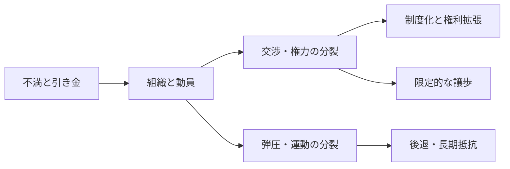
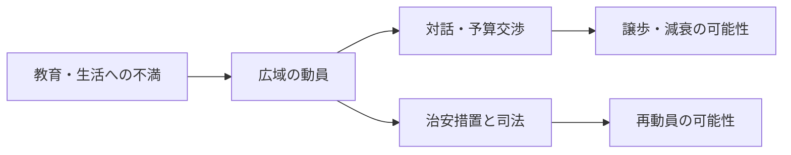

# 街頭から制度へ：世界の民主化史とフランスの現在地

民主化の歴史には、王権や軍政に抗議して選挙を実現した運動、既存の憲法を使って排除された人びとの権利を広げた運動、選挙で成立した権力の暴走を止めようとした運動がある。指導者を退陣させても、軍が実権を保持したり、新しい政権が反対派を抑圧したりすれば、参加者が求めた自由は定着しない。

ここでは「何人集まったか」に加えて、誰が権力を制限できるようになったか、誰が投票・発言・組織化に参加できるようになったかを問う。国連加盟193か国と聖座・パレスチナを国別記録の基準とし、台湾・コソボは別枠で扱う。国別概説と出典・比較上の限界は[国別記録と重要事件の資料集](/reports/global-democracy-protest-history/sources/)に、選定・検証方法は[調査ログ](/reports/global-democracy-protest-history/research/)に収めた。すべての国を同じ深さで研究したという意味ではない。<SourceNote>[国連図書館・加盟国](https://research.un.org/en/unmembers/currentmembers)、[非加盟オブザーバー](https://research.un.org/en/unmembers/observers)</SourceNote>

## 民主主義、民主化、デモを分ける

民主主義の評価には、競争的選挙、市民の権利、政府を制約する法と司法、政治参加を含める。International IDEAはこれらを代表、権利、法の支配、参加の四領域で測る。民主化はその保障を広げる過程、民主主義擁護は既存の保障を維持・回復する過程として読める。<SourceNote>[International IDEA・GSoD技術ガイド2026](https://www.idea.int/publications/catalogue/html/global-state-democracy-indices-technical-procedures-guide-version-10)</SourceNote>

デモは要求を可視化する手段である。生活費の引下げ、独立、宗教的規範、排外的政策、選挙結果の否定など、参加者が掲げる目的は異なる。大規模であることや反政府であることから、その目的が多元主義や平等な参加権を広げるとは判断できない。独立、共和制、複数政党制、民主主義も、それぞれ別に確認する必要がある。

| 運動・変化 | 確認する結果 |
| --- | --- |
| 政策抗議 | 対象政策を変更したか |
| 権利拡張 | 誰が新しく参加・保護の対象になったか |
| 政権交代 | 指導者・与党が交代したか |
| 民主化 | 競争、自由、権力制限が広がったか |
| 民主主義の定着 | 敗者も次の競争に参加でき、交代が反復できるか |

年次指数と今日の情勢も分ける。V-Demの2026年報告は2025年末を中心に評価し、Regimes of the World分類で民主政87、専制政92とする。対象の179単位を、本稿の195か国の分母に置き換えることはできない。2026年の刊行物というだけで、10月の抗議まで評価した資料とは限らない。<SourceNote>[V-Dem・Democracy Report 2026, p.10](https://www.v-dem.net/documents/75/V-Dem_Institute_Democracy_Report_2026_lowres.pdf)</SourceNote>

## 原因から結果までを追う六つの問い

1. 長期の不満は何か。権力独占、差別、植民地支配、腐敗、格差、雇用不安などを区別する。
2. 何が抗議の引き金になったか。死亡事件、選挙不正、値上げ、法改正、クーデターは背景そのものとは違う。
3. 誰が組織したか。学生、労組、宗教団体、政党、地域団体が、共通要求と交渉の経路を作ったか。
4. 政府・軍・警察はどう対応したか。譲歩と弾圧は同時に起きることもあり、支配層内部の分裂も結果を左右する。
5. 何がすぐに変わったか。政策撤回、指導者退陣、選挙、拘束、戦争化を別々に記録する。
6. 何が後に残ったか。投票権、司法の独立、文民統制、自由な結社、平和的な政権交代が続いたかを追う。

次の図は一本道の発展段階ではなく、同じ動員が異なる結果に分かれる関係を示す。

非暴力抵抗の比較研究では、参加者の多様性や組織の持続力が成果と関係する一方、2010年代には成功率が低下した。動員の大きさを一日の写真だけで測ったり、特定の人口比率を超えれば必ず成功すると考えたりするのは適切でない。以下の因果説明は、各事件の文脈と資料を踏まえた解釈であり、普遍的な成功法則ではない。<SourceNote>[Erica Chenoweth・The Future of Nonviolent Resistance](https://www.journalofdemocracy.org/articles/the-future-of-nonviolent-resistance-2/)</SourceNote>

## 代表の範囲を広げる：王権制限から普通選挙へ

### 英国：議会の権力と、人びとの投票権は別に成立した

1688～89年の王位交代と権利章典は、国王による法の停止や課税を制限し、議会の地位を強めた。宗教対立と王権・議会の争いから生まれた体制であり、住民全体が等しく参加する民主主義ではなかった。1832年の選挙法改革も、都市の代表を増やす一方で財産資格を残した。<SourceNote>[英国議会図書館・権利章典](https://commonslibrary.parliament.uk/research-briefings/sn00293/)、[英国議会・1832年改革](https://www.parliament.uk/about/living-heritage/evolutionofparliament/2015-parliament-in-the-making/get-involved1/2015-banners-exhibition/paula-stevens-hoare/the-great-reform-act-1832-gallery/)</SourceNote>

その排除に対して、チャーティストは1838年の人民憲章で男性普通選挙、秘密投票、議員への財産資格撤廃などを要求した。請願は当時の議会に退けられたが、要求の多くは後年に制度化された。女性の参政権運動も請願、組織化、直接行動を重ねた。1918年法は男女に異なる資格を設定し、同じ選挙資格を認めたのは1928年だった。短期に退けられた運動が制度変更の論点を残した例である。<SourceNote>[英国議会・チャーティスト運動](https://www.parliament.uk/about/living-heritage/transformingsociety/electionsvoting/chartists/overview/chartistmovement/)、[女性参政権](https://www.parliament.uk/about/living-heritage/transformingsociety/electionsvoting/womenvote/)</SourceNote>

### 女性と先住民：早い選挙制度にも排除があった

ニュージーランドでは、ケイト・シェパードらの組織と大規模な署名運動が1893年の女性の議会選挙投票権につながった。ただし女性の被選挙権は別の時期に実現した。オーストラリアの1902年法も女性の国政参加を広げたが、人種的排除を残した。先住民全体への連邦投票権拡大は1962年であり、1967年国民投票による憲法改正とは違う出来事である。「女性が投票できた最初の年」だけでは、誰がなお排除されていたかを捉えられない。<SourceNote>[NZHistory・女性参政権](https://nzhistory.govt.nz/politics/womens-suffrage/brief-history)、[豪国立博物館・1902年法](https://www.nma.gov.au/defining-moments/resources/franchise-act)、[豪選挙委員会・先住民参政権](https://www.aec.gov.au/indigenous/milestones.htm)</SourceNote>

## アメリカ大陸：独立、解放、軍政からの移行

### 米国：建国時の理念を、排除された人びとが使い直した

1776年の独立宣言と1787年憲法は人民による統治、共和制、権力分立の基礎となった。しかし奴隷制、先住民の排除、女性の参政権欠如、州ごとの財産資格と併存した。憲法の「5分の3条項」は奴隷に部分的な投票権を与えた規定ではなく、投票できない奴隷人口を代表配分に算入して奴隷保有州の政治力を増す妥協だった。<SourceNote>[米国立公文書館・憲法成立](https://www.archives.gov/founding-docs/constitution/how-did-it-happen)、[権利の記録](https://www.archives.gov/exhibits/documented-rights/exhibit/)</SourceNote>

南北戦争と再建期には、奴隷化された人びとの逃亡・軍務・組織化、奴隷廃止運動、連邦の立法が重なり、修正13～15条で奴隷制廃止、市民権、法の平等保護、人種を理由とする投票権否定の禁止が進んだ。だが白人至上主義の暴力、連邦の保護後退、人頭税や識字試験は黒人の政治参加を再び奪った。憲法の文言を残したまま権利を使えなくする逆行だった。1920年の修正19条も性別による投票権否定を禁じたが、人種的な障壁まで取り除いたわけではない。<SourceNote>[米議会図書館・黒人の投票史](https://www.loc.gov/classroom-materials/elections/voters/african-americans/)、[米国立公文書館・修正19条](https://www.archives.gov/milestone-documents/19th-amendment)</SourceNote>

1950～60年代の公民権運動では、黒人の教会、地域組織、女性活動家、学生がボイコット、座り込み、行進、訴訟を組み合わせた。モンゴメリー、バーミングハム、ワシントン、セルマでの動員と弾圧の可視化が、議会内交渉や連邦政府への圧力につながった。1964年公民権法と1965年投票権法は、街頭の要求を執行可能な法律へ変えた成果である。英雄一人や一日の行進だけが法律を成立させたわけではない。<SourceNote>[米国立公文書館・SNCC](https://www.archives.gov/research/african-americans/black-power/sncc)、[セルマ](https://www.archives.gov/research/african-americans/vote/selma-marches)、[公民権法](https://www.archives.gov/milestone-documents/civil-rights-act)、[投票権法](https://www.archives.gov/milestone-documents/voting-rights-act)</SourceNote>

法的な隔離廃止後も、住宅・資産・警察との関係の不平等は残った。2020年のBlack Lives Matterの大動員は、ジョージ・フロイド殺害を契機に警察の説明責任と人種的平等を要求した。ACLEDが記録した特定期間の抗議の多くは非暴力だったが、個別の略奪や暴力、警察の過剰な実力行使は別々に検証する必要がある。議題を変えたことと、全国一律の制度改善を達成したことは異なる。<SourceNote>[ACLED・2020年夏の抗議調査](https://acleddata.com/report/demonstrations-and-political-violence-america-new-data-summer-2020)</SourceNote>

対照的に2021年1月6日の議事堂襲撃は、有効な選挙結果の確定を妨げた。下院調査委員会は、選挙結果を覆そうとする一連の働きかけの中に事件を位置づけた。街頭に集まることや制度に異議を唱えることだけでは、民主化運動と呼べない。2025～26年のNo Kings抗議は権力集中などへの反対を掲げ、2026年10月17日の集会では次の選挙参加が呼びかけられた。11月の選挙結果は基準日時点で未確定であり、街頭の規模から勝敗を予測しない。<SourceNote>[米議会・1月6日調査最終報告](https://www.govinfo.gov/collection/january-6th-committee-final-report)、[AP・2026年10月17日](https://apnews.com/article/02d78e3dc4f1f75f8f8a5c327ba79008)</SourceNote>

### ハイチとメキシコ：解放と社会革命の後に残る制度の問題

ハイチでは1791年に始まった奴隷化された人びとの蜂起が、植民地支配との戦争を経て1804年の独立につながった。自由と平等の普遍性を、奴隷所有社会そのものに突きつけた世界史的転換である。ただし奴隷制廃止と独立は、安定した競争的議会制の完成を意味しなかった。フランスが1825年に課した賠償、国際的孤立、国内の権力対立なども国家形成を制約した。1986年のデュバリエ体制崩壊、1990年のアリスティド当選と翌年のクーデターは、さらに別の民主化過程だった。<SourceNote>[スミソニアン・革命と民主主義](https://www.americanhistory.si.edu/explore/exhibitions/american-democracy/online/great-leap/great-debates/revolutionary-world)、[米議会調査局・ハイチの民主化史](https://www.everycrsreport.com/reports/93-931.html)</SourceNote>

メキシコの1910年革命は、ディアスの長期支配と再選、土地・労働の問題をめぐる異なる勢力の闘争だった。1917年憲法は社会権を取り入れたが、その後の長期与党優位体制は対等な競争を制限した。1968年の学生運動へのトラテロルコでの弾圧、1988年選挙への不信を経て、選挙制度改革と監視の蓄積が2000年の政権交代を可能にした。革命、社会権、競争選挙は同時に完成したのではない。<SourceNote>[メキシコ選挙機関・民主主義史](https://farodemocratico.ine.mx/la-democracia-en-mexico/?mode=grid)、[National Security Archive・1968年の文書](https://nsarchive2.gwu.edu/NSAEBB/NSAEBB10/intro.htm)</SourceNote>

### ブラジル、アルゼンチン、チリ：軍政を終える経路は異なった

ブラジルの1984年Diretas Jáは、大統領直接選挙を求めて労働者、学生、野党、市民を結びつけた。直接選挙を直ちに実現する憲法改正は議会で成立しなかったが、軍政の正統性を弱め、1985年の文民移行、1988年憲法、1989年直接選挙につながる圧力となった。一つの採決の敗北と長期の政治効果を区別できる。<SourceNote>[ブラジル下院・Diretas Já](https://www.camara.leg.br/noticias/143271-decada-de-80-as-diretas-ja/)、[上院・憲法史](https://www.senado.leg.br/noticias/especiais/constituicao25anos/historia-das-constituicoes.htm)</SourceNote>

アルゼンチンでは1976年以降の軍政による失踪・拷問に対し、五月広場の母たちなどが家族の行方と国家の責任を問い続けた。経済危機、労働運動、1982年の戦争敗北も軍の支配を弱め、1983年に選挙による文民政権が成立した。民主化後の真相究明と裁判は重要な成果だったが、免責をめぐる後退と再開もあり、選挙後に国家暴力の責任をどう問うかが長期の争点となった。<SourceNote>[アルゼンチン政府・母たちの行進](https://www.argentina.gob.ar/noticias/44-anos-de-la-primera-ronda-de-madres-de-plaza-de-mayo)、[1983年選挙](https://www.argentina.gob.ar/dine/elecciones-1983)、[議会図書館・民主制40年](https://bcn.gob.ar/muestras-virtuales/audioguia-40-hitos-en-40-anos-de-democracia)</SourceNote>

チリでは労組、市民社会、政党の抵抗と組織化が、1988年国民投票でのピノチェト続投否決、1990年の文民移行へつながった。旧体制の憲法と軍の影響は移行後にも残った。2019年には地下鉄運賃を引き金とする抗議が、年金、格差、社会保障への不満を集めたが、新憲法案は2022年と2023年にそれぞれ否決された。抗議が制憲の議題を開いたことと、有権者が特定の草案を承認したかは別の結果である。<SourceNote>[チリ政府・国連提出基礎文書2024](https://documents.un.org/access.nsf/get?DS=HRI%2FCORE%2FCHL%2F2024&Lang=E&OpenAgent=)、[AP・2023年国民投票](https://apnews.com/article/f7be231ff564856f6a5e1b0c0ac12c57)</SourceNote>

グアテマラの1944年の民主的開放は1954年の米国が支援したクーデターで断たれ、その後の内戦ではマヤ先住民が甚大な被害を受けた。1985年憲法と1996年和平後も、司法と政治への権力集中は残った。2023～24年に先住民組織などがアレバロの選挙勝利と就任を守るため動員したことは、既にある選挙の結果を実効的な権力移譲へつなぐ民主主義擁護として位置づけられる。<SourceNote>[米州人権委員会・グアテマラ2025](https://www.oas.org/en/iachr/reports/pdfs/2025/informe_guatemala_en.pdf)</SourceNote>

## アジア：軍の拒否権、選挙の公正、社会的平等

### 中国・天安門：改革への期待が軍事的鎮圧に終わった

1989年の中国では、経済改革に伴う物価上昇、腐敗、特権への反発と、政治参加・言論の拡大を求める期待が重なった。4月の胡耀邦の死と追悼を契機に、学生の集会は北京だけでなく他の都市にも広がり、労働者や市民も参加した。ただし学生と労働者、改革派知識人の要求や組織は同一ではなかった。<SourceNote>[National Security Archive・天安門関連公文書](https://nsarchive2.gwu.edu/NSAEBB/NSAEBB16/)、[Amnesty International・1989年の記録](https://www.amnesty.org/en/projects/the-1989-tiananmen-crackdown/)</SourceNote>

指導部内の対話・改革をめぐる対立の後、戒厳令と軍の投入が進み、6月3日夜から4日にかけて軍が北京で市民を殺傷し、抗議を鎮圧した。犠牲者は広場の内部だけでなく周辺道路などでも生じており、独立した検証が制限される中で死者の確定総数を置くことはできない。拘束、処罰、検閲は運動を公然と続ける可能性を奪った。<SourceNote>[National Security Archive・1989年6月の文書群](https://nsarchive2.gwu.edu/NSAEBB/NSAEBB16/)</SourceNote>

短期の結果は政治的開放の後退だった。その後に市場化や成長が進んだことを、競争的選挙や権力制限の拡大と同じものとみなせない。天安門は、動員規模や経済発展だけでは、軍の忠誠と支配層の選択を乗り越えられない事例として比較できる。同時に、亡命、記憶の継承、遺族の責任追及という長期の活動を、街頭運動の鎮圧によって消えたものとして扱わない。<SourceNote>[Amnesty International・天安門の記憶と責任追及](https://www.amnesty.org/en/projects/the-1989-tiananmen-crackdown/)</SourceNote>

### ミャンマー：大統領交代ではなく、軍支配への反復的な抵抗

1988年には経済停滞、紙幣廃止の損失、学生への暴力に反発する全国的蜂起が起きた。軍は殺傷と逮捕で抑圧し、1990年にNLDが選挙で勝っても政権を移譲しなかった。2007年のサフラン革命は燃料値上げから広がり、僧侶への暴力を受けて宗教者と市民の連携が強まったが、軍政は僧院への突入、発砲、拘束で鎮圧した。両運動は別の引き金と組織を持つ。<SourceNote>[BTI・ミャンマーの制度史](https://bti-project.org/en/reports/country-report/MMR)、[国連・2007年特別報告](https://digitallibrary.un.org/record/613501/files/A_HRC_6_14-EN.pdf)</SourceNote>

2011年以降の部分開放は政治活動と選挙の余地を広げたが、2008年憲法は軍に議席の4分の1と重要な治安権限を残した。ロヒンギャの排除と迫害も続き、選挙の多数派の自由だけを民主化の尺度にできない。2021年2月1日のクーデターで軍が拘束したのはウィンミン大統領と、国家顧問のアウンサンスーチーらである。スーチーは大統領ではなかった。<SourceNote>[Freedom House・ミャンマー2026年版](https://freedomhouse.org/country/myanmar/freedom-world/2026)、[国連特別報告者・2021年](https://www.ohchr.org/en/HRBodies/HRC/RegularSessions/Session46/Documents/A_HRC_46_56.pdf)</SourceNote>

医療者、公務員、労働者らの市民的不服従運動と街頭抗議は、軍の暴力が続く中で、一部の武装抵抗とも結びついた。非暴力の参加者、人民防衛隊、以前から戦っていた民族武装組織には異なる目標と指揮系統があり、「同じデモ隊」とは呼べない。2025年末～2026年初めの軍主導選挙と、4月のミンアウンフライン大統領就任も、自由で包摂的な選択への転換とは評価できない。役職の変更と、軍を市民が統制できる制度の成立を分ける必要がある。<SourceNote>[OHCHR・2025年年次更新、2026年2月公表](https://bangkok.ohchr.org/sites/default/files/documents/2026-02/ohchr_myanmar_annual_update_2025.pdf)、[AP・2026年1月25日](https://apnews.com/article/48f9f80748a23ce4ac9d7a1ea476f1f4)、[AP・2026年4月10日](https://apnews.com/article/fca4366fed164acd0fb86d7f13891bc9)</SourceNote>

### イラン：立憲革命、王制打倒、選挙と身体の自由を求める運動

1906年の立憲革命では、商人、宗教者、知識人、地方の結社が、恣意的な統治と外国の影響に対し議会と法による王権制限を求めた。1906年憲法と1907年補則はその成果だったが、王権側の攻撃、外国介入、財政難が制度を弱めた。1953年には石油国有化を進めたモサッデク首相が、米英の関与と国内勢力の行動によるクーデターで倒された。彼は直接選ばれた大統領ではなく、議会政治の下の首相だった。<SourceNote>[Encyclopaedia Iranica・立憲革命](https://www.iranicaonline.org/articles/constitutional-revolution/)、[米国務省FRUS・1953年10月8日文書](https://history.state.gov/historicaldocuments/frus1951-54IranEd2/d328)</SourceNote>

1979年の革命では、シャーの抑圧、急速な社会変化と格差、政治参加の閉鎖に対し、宗教勢力、自由主義者、左派、学生、商人、労働者が王制打倒で連携した。追悼集会とストライキが支配を揺さぶったが、革命後にはホメイニと宗教機関が権力を固め、競合勢力を排除した。選挙と、最高指導者・監督者評議会による非選挙的な権限が併存する体制となった。共通の敵を倒す連合は、その後の多元的制度への合意を意味しなかった。<SourceNote>[BTI・イランの移行史と制度](https://bti-project.org/en/reports/country-report/IRN)</SourceNote>

2009年の緑の運動は大統領選挙への不信を中心に説明責任を求め、2022年の「女性・生命・自由」はジナ（マフサ）・アミニの拘束後の死を契機に、服装の強制、尊厳、差別、統治体制を争点にした。女性、若者、民族的少数者らの街頭行動と日常的な不服従は、票の集計だけに還元できない権利要求だった。国連事実調査団は殺害、拷問、性暴力などを認定している。調査団の法的評価は、個人の刑事責任についての確定判決とは区別する。<SourceNote>[Freedom House・イラン2026年版](https://freedomhouse.org/country/iran/freedom-world/2026)、[国連事実調査団・2024年9月更新](https://www.ohchr.org/sites/default/files/documents/hrbodies/hrcouncil/ffmi-iran/FFM-Iran-Update-13-September-2024.pdf)</SourceNote>

2025年末～2026年初めには通貨・物価危機から抗議が広がり、当局による大規模な殺傷と通信制限が報告された。国連人権理事会は調査の継続を決めた。抗議への弾圧、後の外国の軍事行動、体制内部の指導者継承はそれぞれ別の過程であり、いずれかを市民の民主化要求の達成と読み替えない。<SourceNote>[HRW・2026年1月16日調査](https://www.hrw.org/news/2026/01/16/iran-growing-evidence-of-countrywide-massacres)、[国連・1月23日人権理事会](https://www.ungeneva.org/es/news-media/meeting-summary/2026/01/human-rights-council-adopts-resolution-extending-mandates-fact)、[AP・2026年3月の継承](https://apnews.com/article/f0b20dbffaea9351ae1e54183ffe53ff)</SourceNote>

### マレーシア：選挙がある体制で、競争の条件を変える

1998年のReformasiは、金融危機下のマハティールとアンワルの対立、アンワルの解任・拘束を直接の契機とした。若者、市民団体、野党などは腐敗、司法・警察の政治利用、権威主義を批判した。直ちに与党を退かせることはできなかったが、後の野党協力と市民組織の基盤を作った。<SourceNote>[ISEAS・政治秩序の変化](https://www.iseas.edu.sg/wp-content/uploads/2021/12/ISEAS_Perspective_2022_2.pdf)</SourceNote>

Bersihは2007年以降の大集会や選挙監視を通じ、有権者名簿、選挙制度、メディアへの接近など競争の入口を争った。多民族の市民の連携は、長期与党優位の選挙政治に対抗する組織的な力となった。2018年の初の連邦政権交代には、この蓄積に加え、1MDB問題、生活費への不満、支配層の分裂が作用した。単一のデモで政権が倒れたわけではない。<SourceNote>[ISEAS・Bersihの長期的影響](https://www.iseas.edu.sg/articles-commentaries/iseas-perspective/2021-167-the-profound-impact-of-the-bersih-movement-since-2007-by-khoo-boo-teik/)</SourceNote>

2020年の連立再編による政権崩壊と、2022年選挙後の統一政府は、交代可能性の実現後も制度改革が不安定であることを示した。改革を掲げた勢力が勝つこと、選挙を公正にすること、司法と表現の自由を守ることは、同じ達成ではない。<SourceNote>[Freedom House・マレーシア2026年版](https://freedomhouse.org/country/malaysia/freedom-world/2026)</SourceNote>

### 韓国と台湾：過去の弾圧を、競争のルールの変更へつなぐ

韓国の1960年四月革命は不正選挙と警察暴力に反発して李承晩を退陣させたが、翌年の軍事クーデターで民主的な開放は覆された。1980年光州では軍の暴力に対する市民の抗議と抵抗を軍が鎮圧した。短期の敗北後も犠牲者家族、市民組織、宗教者の記録と活動が残り、民主化の正統性を支えた。1987年には拷問死と隠蔽、改憲拒否に反発する学生、労働者、会社員、教会、野党の動員が拡大し、政府側は大統領直接選挙を受け入れた。<SourceNote>[UNESCO・四月革命記録](https://www.unesco.org/en/memory-world/archives-april-19-revolution)、[光州記録](https://www.unesco.org/en/memory-world/human-rights-documentary-heritage-1980-archives-may-18th-democratic-uprising-against-military-regime)、[韓国民主化運動記念事業会・1987年](https://archives.kdemo.or.kr/display/en/move610.html)</SourceNote>

その年の選挙には旧軍政側の盧泰愚が勝った。成果はその場で野党へ政権を渡したことではなく、交代を可能にするルールを変えたことにあった。2016～17年のろうそく集会は議会の弾劾と憲法裁判所による朴槿恵罷免へ接続した。2024年末の戒厳令に対しても議会と市民が抵抗し、憲法裁判所は2025年4月に尹錫悦を罷免した。街頭の人数が判決に代わったのではなく、市民の行動と憲法手続が権力を制約した。<SourceNote>[BTI・韓国の制度史](https://bti-project.org/en/reports/country-report/KOR)、[韓国憲法裁判所・2025年4月4日](https://english.ccourt.go.kr/site/kor/ex/bbs/View.do?bcIdx=4243079&cbIdx=1127)</SourceNote>

台湾では白色テロと長期戒厳令の下でも、地方選挙、党外運動、被告の家族や弁護団が政治活動を続けた。1979年美麗島事件の弾圧、1986年の民進党結成、1987年の戒厳令解除、1990年の野百合学生運動、1996年の総統直接選挙、2000年の政権交代は、それぞれ異なる転機である。市民の圧力、経済・社会の変化、国民党内部の改革判断を組み合わせて説明する必要がある。<SourceNote>[BTI・台湾の制度史](https://bti-project.org/en/reports/country-report/TWN)、[日本外務省・台湾の基本資料と年表](https://www.mofa.go.jp/mofaj/area/taiwan/data.html)、[Swarthmore・野百合運動](https://nvdatabase.swarthmore.edu/content/taiwanese-student-sit-democratic-reform-wild-lily-movement-1990)</SourceNote>

民主化後の2014年ひまわり運動は、対中サービス貿易協定の審議過程と監督を争った。独裁を終える要求と、民主制内部で決定の透明性を求める要求は区別できる。台湾の経験を特定文化に民主主義が「向く／向かない」とする説明に使うのではなく、支配層、組織、制度改革がどう結びついたかを比較する。<SourceNote>[Freedom House・台湾2026年版](https://freedomhouse.org/country/taiwan/freedom-world/2026)</SourceNote>

### フィリピンとインドネシア：大衆動員に支配層の離反が重なった

フィリピンではマルコスの権力集中と縁故経済、経済危機への不満に、1983年のベニグノ・アキノ暗殺、1986年選挙の不正が重なった。野党の結集、教会と放送による呼びかけ、市民の非暴力行動に、軍幹部の離反と米国の支持変更が加わり、EDSAのPeople Powerはマルコス退陣へ至った。1987年憲法は権利と権力分立を再構成したが、土地・富の集中、政治家一族、軍の影響は残った。首都の数日間だけで長期の抵抗史を説明しない。<SourceNote>[EDSAの史料付き年表](https://www.gmanetwork.com/news/topstories/specialreports/600884/a-timeline-of-the-1986-edsa-people-power-revolution/story/)、[フィリピン政府公報・憲法制定](https://officialgazette.gov.ph/constitutions/constitution-day/)、[BTI・フィリピン](https://bti-project.org/en/reports/country-report/PHL)</SourceNote>

インドネシアでは1997年の金融危機が物価、雇用、銀行・政商関係の問題を深め、スハルト体制の支持を崩した。1998年5月の学生射殺、全国の学生動員、議会占拠、閣僚や議会指導者の離反が重なり、5月21日にスハルトは辞任した。同時期の華人への殺害・略奪・性暴力を、民主化の正当な手段や必要な犠牲として扱ってはならない。<SourceNote>[IMF独立評価室・金融危機](https://www.imf.org/external/np/ieo/2003/cac/pdf/all.pdf)、[HRW・学生運動](https://www.hrw.org/report/1998/08/01/academic-freedom-indonesia/dismantling-soeharto-era-barriers)、[華人女性への暴力](https://www.hrw.org/legacy/reports/reports98/indonesia3/violence.htm)</SourceNote>

その後の1999年選挙、地方分権、憲法改正、2004年大統領直接選挙は、退陣を制度変更へつないだ。ただし旧来の経済エリートは新制度に適応し、汚職、軍の関与、少数者の権利、過去の暴力の責任追及は未解決のまま残った。両国では「指導者を去らせる力」と「その後の権力を分散する力」を別々に見る必要がある。<SourceNote>[BTI・インドネシア](https://bti-project.org/en/reports/country-report/IDN)</SourceNote>

### インド、バングラデシュ、ネパール：独立と包摂的な制度は別の課題

インドの独立運動には、ガンディーや国民会議に加え、農民、労働者、女性、ムスリムの組織、アンベードカルら被差別者の運動が参加し、独立後の構想は異なった。非協力、不買、塩の行進は日常の要求を主権の問題へ結びつけたが、1947年の独立は分割と大規模な暴力・移動を伴った。1950年憲法と1951～52年総選挙が、貧困や識字を参政権制限の理由にせず普通選挙を制度化したことは重要である。政治的平等だけでカースト、土地、ジェンダーの格差が消えたわけではない。<SourceNote>[Stanford・ガンディー研究](https://kinginstitute.stanford.edu/gandhi-mohandas-k)、[英国国立公文書館・分割](https://www.nationalarchives.gov.uk/education/teaching-resources/partition-of-british-india/)、[インド選挙管理委員会・普通選挙史](https://www.eci.gov.in/EBooks/Leap-of-Faith/files/basic-html/page34.html)</SourceNote>

1975年には経済不満と反政府運動、首相の選挙をめぐる判決を背景に、インディラ・ガンディー政権が非常事態を宣言し、検閲と野党拘禁を進めた。1977年に選挙を実施して与党が敗北を受け入れたことが、自由の回復を可能にした。後の第44次憲法改正は非常事態権限に制約を加えた。選出された指導者による後退と、選挙を通じた修復の両方を示す事例である。<SourceNote>[当時の報道に基づくTIMEの検証](https://time.com/3935184/indira-gandhi-emergency-40-years-1975/)、[インド政府・非常事態と憲法改正の記録](https://www.pib.gov.in/FactsheetDetails.aspx?Id=149224&lang=1&reg=48)</SourceNote>

バングラデシュの1971年独立は、東パキスタンへの地域・言語差別と、1970年選挙で多数を得たアワミ連盟への権力移譲拒否から、弾圧と戦争を経て成立した。その後も一党化と軍事支配を経験し、1990年の反軍政運動が議会制の回復へつながった。2024年には公務員採用枠をめぐる学生抗議が、治安部隊などの殺傷への怒りによって反政権運動へ拡大し、ハシナ退陣に至った。生活上の不公平への要求を、政府自身の暴力が統治の正統性の問題へ変えた。<SourceNote>[National Security Archive・1971年](https://nsarchive2.gwu.edu/NSAEBB/NSAEBB79/)、[BTI・バングラデシュ](https://bti-project.org/en/reports/country-report/BGD)、[OHCHR・2024年抗議の事実調査](https://www.ohchr.org/sites/default/files/documents/countries/bangladesh/ohchr-fftb-hr-violations-bd.pdf)</SourceNote>

暫定統治を経て2026年2月に選挙と新首相就任へ進んでも、少数者への攻撃、報復、旧与党の排除、警察・司法の党派性は別に評価する必要がある。勝者の権利だけを守る移行では、以前の排除を繰り返す危険が残る。<SourceNote>[AP・2026年2月17日](https://apnews.com/article/fbc4222e01bbc5aa7ac120801218ef24)、[OHCHR・事実調査報告](https://www.ohchr.org/sites/default/files/documents/countries/bangladesh/ohchr-fftb-hr-violations-bd.pdf)</SourceNote>

ネパールでは1990年の人民運動が国王中心の体制を立憲君主制と複数政党制へ変えたが、社会的排除と貧困は残り、1996年からマオイスト武装闘争が続いた。2005年の国王の直接統治に対し、主要政党とマオイストが接近し、2006年の市民の抗議とストが議会復活を促した。同年の包括的和平合意、制憲議会、2008年共和制、2015年連邦憲法へと進んだ。街頭運動、敵対勢力との政治合意、戦争の終結、制憲を連結した例であり、過去の加害責任と包摂的な代表の問題は残った。<SourceNote>[Swarthmore・1990年人民運動](https://nvdatabase.swarthmore.edu/content/nepalese-force-king-accept-democratic-reform-jana-andolan-peoples-movement-1990)、[OHCHR・2006年の抗議調査](https://nepal.ohchr.org/en/resources/Documents/English/statements/HCR/Year2006/2006_09_21_HCR_DJ.pdf)、[包括的和平合意](https://peacemaker.un.org/sites/default/files/document/files/2024/05/np061122comprehensive20peace20agreement20between20the20government20and20the20cpn2028maoist29.pdf)</SourceNote>

日本でも、自由民権、大正期の政党政治と1925年男性普通選挙、軍国主義による抑圧、敗戦・占領下の改革を区別する必要がある。1946年に女性が初めて総選挙で投票し、1947年憲法は国民主権と基本的人権を制度化した。1960年の安保反対運動は岸首相の退陣を促した一方、条約改定の発効を阻止しなかった。占領という外部条件、国内の運動、立法と選挙の働きを分ければ、民主化と民主制内部の政策抗議の違いが見える。<SourceNote>[国立国会図書館・日本国憲法の誕生](https://www.ndl.go.jp/constitution/)、[国立国会図書館・1925年の参政権と治安維持法](https://www.ndl.go.jp/modern/cha3/description13.html)、[Nick Kapur・1960年安保の研究](https://apjjf.org/2020/18/Kapur)</SourceNote>

## アフリカ：人種的解放、国民会議、革命後の軍の権力

### 南アフリカ：政治的平等を交渉と憲法で保障する

アパルトヘイトは人種によって投票、土地、居住、教育、移動を制限した。1952年の不服従運動、1955年自由憲章、1960年シャープビル、1976年ソウェトは、異なる世代と組織を動員した。1980年代にはUDF、労組、教会、地域組織の活動が広がった。非暴力運動、地下活動、武装闘争、国家暴力が併存する歴史を、一つの戦術や指導者だけへ還元できない。<SourceNote>[South African History Online・自由憲章](https://sahistory.org.za/article/background-freedom-charter-1955)、[1960・1976・1990年の転機](https://sahistory.org.za/classroom/grade-9/turning-points-1960-1976-and-1990)</SourceNote>

国内の抗議と統治の困難、制裁と経済的負担、軍事的決着の難しさ、冷戦の終結が交渉の条件を変えた。1990年の解放組織合法化とマンデラ釈放後も、暴力と交渉の決裂は続いた。暫定的な権力分有と全人種の選挙権を組み合わせ、1994年選挙、1996年憲法へ進んだ点に制度的意義がある。多数決で勝った政府にも権利章典と司法による制限を設けた。<SourceNote>[ネルソン・マンデラ財団・交渉1985～94年](https://www.nelsonmandela.org/talking-to-the-enemy-1985-to-1994)、[南ア司法省・憲法](https://www.justice.gov.za/constitution/basicprov.html)</SourceNote>

政治的平等を保障しても、人種化された資産・雇用・居住の格差は消えなかった。2024年にANCが議会過半数を失ったことも、解放運動の正統性と有権者の現在の判断が同じではないことを示す。民主化の成果と、生活条件・汚職・公共サービスへの批判は両立する。<SourceNote>[Freedom House・南アフリカ2026年版](https://freedomhouse.org/country/south-africa/freedom-world/2026)</SourceNote>

### ベナンとガーナ：移行の合意を、敗北を受け入れる制度へ変える

ベナンでは一党体制の財政危機と賃金不払いに、公務員、学生、教員らが抗議した。1990年の国民会議は単なる意見聴取を超えて主権的な権限を主張し、暫定制度と憲法制定へ進んだ。1991年にケレクが選挙での敗北を受け入れたことが、交渉を実際の権力移譲へ変えた。他のフランス語圏諸国にも参照されたが、会議という形式だけで同じ成果が得られるわけではない。その後の選挙規則や司法を通じた競争制限は、一度の成功の脆さも示す。<SourceNote>[Gisselquist・ベナンの移行研究](https://research.birmingham.ac.uk/en/publications/democratic-transition-and-democratic-survival-in-benin/)、[Freedom House・ベナン2026年版](https://freedomhouse.org/country/benin/freedom-world/2026)</SourceNote>

ガーナでは軍政が国内の民主化要求に応じて開放を管理し、1992年憲法と複数政党選挙へ進んだ。当初は現職側が有利で、野党の不信も強かった。選挙管理、報道、市民社会、政党間の競争が積み重なり、2000年選挙と翌年の就任で野党への交代が実現した。選挙を実施する段階から、現職が負けてもルールを維持する段階への変化である。<SourceNote>[Stanford CDDRL・ガーナ移行研究](https://cddrl.fsi.stanford.edu/publications/the_world_bank_made_me_do_it_international_factors_and_ghanas_transition_to_democracy)、[Freedom House・歴史研究](https://www.refworld.org/reference/countryrep/freehou/2008/63832)</SourceNote>

### アラブの春：同じ波でもチュニジアとエジプトは分岐した

チュニジアでは地域格差、失業、腐敗、警察の恣意的な扱いが蓄積し、2010年12月のブアジジの焼身を契機に抗議が拡大した。地方の若者、労組、弁護士、人権活動家が動員を支え、2011年1月にベンアリは退いた。SNSだけで成立した運動ではない。2013年の暗殺と政治対立による危機には、労組、経営者、人権団体、弁護士会の対話カルテットが妥協を仲介し、2014年憲法と選挙を支えた。<SourceNote>[HRW・チュニジア2011年の記録](https://www.hrw.org/world-report/2012/country-chapters/tunisia)、[ノーベル委員会・対話カルテット](https://www.nobelprize.org/prizes/peace/2015/press-release/)</SourceNote>

雇用と地域格差の未解決、政党への失望は民主制への支持を弱めたが、後退が自動的に起きたわけではない。2021年以降、サイード大統領が議会機能を停止し、司法や選挙管理への権限を集中した。革命、憲法制定、選挙を経験した国でも、選出された指導者の行動によって競争と自由は侵食され得る。<SourceNote>[Freedom House・チュニジア2026年版](https://freedomhouse.org/country/tunisia/freedom-world/2026)</SourceNote>

エジプトでは非常事態法、警察暴力、腐敗、生活苦に対する抗議が2011年1月から広がり、労働者のストやタハリール広場の占拠を経てムバラクが退陣した。しかし実権は軍最高評議会へ移った。2012年の大統領選挙でムルシが選ばれても、軍の自律性、旧体制の機構、宗教と国家をめぐる対立は解消しなかった。2013年の反ムルシ大動員後、軍が大統領を排除し、ラバアなどの座り込みを大量の殺傷を伴って排除した。群衆の支持があっても、軍による権力奪取を民主的な交代と同一視できない。<SourceNote>[HRW・エジプト2011年の抗議](https://www.hrw.org/news/2011/01/28/egypt-demonstrators-defy-riot-police-censorship)、[2013～14年の反転](https://www.hrw.org/world-report/2015/country-chapters/egypt)</SourceNote>

### スーダン：繰り返す蜂起を軍が奪い返す

スーダンでは1964年と1985年の学生、専門職、労働者の動員が軍政を退かせたが、後に再び軍事政変が起きた。2018年末のパン価格などへの抗議も、長期支配への拒否へ広がった。専門職協会、地域の抵抗委員会、女性、若者らが支え、2019年4月に軍がバシールを排除した後も、文民統治を求めて座り込みを続けた。<SourceNote>[Tufts・スーダンの民主化比較研究](https://fletcher.tufts.edu/index.php/research/research-publications/sudans-elusive-democratisation-civic-mobilisation-provincial)、[African Studies Review・2018～19年の担い手](https://www.cambridge.org/core/journals/african-studies-review/article/working-peoples-for-political-change-the-20182019-sudanese-uprising/B697A2F4F5274C260748A915F1035B9A)</SourceNote>

6月の武力排除後の交渉は軍と文民の権力分有を作ったが、軍とRSFの独立した強制力を残した。2021年のクーデターは文民側を排除し、2023年にはSAFとRSFの戦争が始まった。この戦争をそのまま民主派と独裁派の戦いと呼ぶことはできない。市民が繰り返し動員できても、軍の政治・経済的権力、地方の排除、武装勢力の統合を解決しなければ、移行は覆され得る。<SourceNote>[HRW・2019年の武力排除調査](https://www.hrw.org/report/2019/11/18/they-were-shouting-kill-them/sudans-violent-crackdown-protesters-khartoum)、[Freedom House・スーダン2026年版](https://freedomhouse.org/country/sudan/freedom-world/2026)</SourceNote>

## 欧州の移行：革命の敗北、交渉、外部の軍事力

### 1848年とワイマール：憲法を書くだけでは守れない

1848～49年の欧州革命には、食糧・経済危機、検閲、君主制への反発が重なった。自由主義者、学生、労働者、農民は憲法、国民国家、生活保障、領主的負担の廃止を求めたが、要求は一致しなかった。フランクフルト国民議会は憲法を採択しても君主の軍事力を制御できず、主要な革命は敗れた。一方で農民解放など残った成果もある。民族的自決の要求が少数民族の権利と衝突し、社会革命への恐れが連合を割るという問題も現れた。<SourceNote>[ドイツ連邦政治教育センター・1848～49年](https://www.bpb.de/themen/zeit-kulturgeschichte/revolution-1848-1849/517884/die-revolutionen-von-1848-49/)、[ドイツ連邦議会・フランクフルト議会](https://www.bundestag.de/en/parliament/history/parliamentarism/1848-247956)、[オーストリア議会・農民解放](https://www.parlament.gv.at/aktuelles/pk/jahr_2008/pk0740)</SourceNote>

1918年の戦争敗北と兵士・労働者の反乱から成立したドイツのワイマール共和制も不可逆ではなかった。恐慌、政治的暴力、議会を迂回する統治、保守エリートの判断が重なり、1933年のヒトラー首相任命後に弾圧と制度破壊が進んだ。ナチ党は最大党となったが、自由な選挙で単独過半数を得て独裁の白紙委任を受けたわけではない。戦後の基本法による再建は、権利と権力分立を守る制度を強める別の出発だった。<SourceNote>[ドイツ連邦議会・ワイマール共和国](https://www.bundestag.de/en/parliament/history/parliamentarism/weimar)、[議会主義の歴史](https://www.bundestag.de/parlament/geschichte/parlamentarismus)</SourceNote>

### ポルトガルとスペイン：軍の行動、街頭の圧力、体制内の交渉

ポルトガルでは長期独裁と植民地戦争の負担が軍内のMFAを動かし、1974年4月25日のカーネーション革命を起こした。市民と労働者の参加が社会改革を広げたが、革命後には路線をめぐる激しい対立が続いた。1975年の制憲議会選挙、1976年憲法、1982年の軍の制度的監督権縮小までを見ると、軍による政変が民主制になるには後続の文民化が必要だったことが分かる。<SourceNote>[ポルトガル議会・民主制の歩み](https://www.parlamento.pt/Parlamento/Paginas/dias-democracia.aspx)、[憲法改正史](https://www.parlamento.pt/sites/EN/Parliament/Paginas/Constitutional-revisions.aspx)</SourceNote>

スペインでは1975年のフランコ死後、労働運動、野党、地域自治の要求と体制内改革派の交渉が重なった。1976年政治改革法、1977年選挙、1978年憲法が議会君主制を制度化した。国王や一人の政治家が自由を与えたという説明では、社会の圧力と妥協が見えなくなる。旧体制の責任追及、地域自治、記憶をめぐる問題は移行後も残った。<SourceNote>[スペイン下院・1978年憲法](https://constitucion.congreso.es/w/constituci%C3%B3n-de-1978)</SourceNote>

### ポーランドと1989年の東欧：組織の持続と、ソ連の介入条件の変化

1956年のハンガリー蜂起と1968年のプラハの春は、自由や主権、体制内の改革を求めたが、ソ連の軍事介入で挫折した。1989年との違いを国内の人数や勇気だけに求めることはできない。外部の軍事力が既存支配を維持するかどうかが、移行の可能性を変えた。<SourceNote>[カナダ国防省・ハンガリー1956年](https://www.canada.ca/en/department-national-defence/services/military-history/history-heritage/past-operations/europe/hungary-1956.html)、[米国務省歴史部・プラハの春](https://history.state.gov/milestones/1961-1968/soviet-invasion-czechoslavkia)</SourceNote>

ポーランドの「連帯」は1980年の労働争議から独立労組と自由を求める大きな運動となり、労働者、知識人、教会が支えた。1981年の戒厳令で地下化しても組織と出版は続き、経済危機とストを経て1989年の円卓会議へ至った。6月選挙は下院に与党側の留保を残す部分的自由選挙だったが、反対派の勝利は非共産党主導政府への移行を促した。全面的自由選挙が一日で完成したという物語とは異なる。<SourceNote>[連帯遺産研究所・歴史資料](https://ids1980.pl/wp-content/uploads/2021/12/IDS_e-book_Album_Wybieram_Solidarnosc-1.pdf)、[欧州議会・民主的変化の記録](https://www.europarl.europa.eu/EPRS/EPRS_STU_538881_Democratic_change_EN.pdf)</SourceNote>

チェコスロバキアでは学生デモへの警察暴力を受けて市民フォーラムなどが組織され、1989年の集会、スト、交渉が共産党の独占撤廃につながった。東ドイツでは教会を拠点とする運動、市民団体、出国者が異なる形で体制へ圧力を加えた。11月の壁開放は象徴的な転機だったが、民主的政府の成立、1990年3月の自由選挙、統一の国際交渉は別の手続を要した。<SourceNote>[チェコ政府・1989年革命](https://vlada.gov.cz/scripts/detail.php?id=64276&tmplid=51)、[ドイツ連邦財団・1989～90年](https://www.bundesstiftung-aufarbeitung.de/de/recherche/dossiers/198990-friedliche-revolution-und-deutsche-einheit)</SourceNote>

バルト三国の歌う革命や1989年「バルトの道」は、文化、歴史の記憶、選挙と議会活動を独立回復へ結びつけた。民主化と国家の自決は結びつく一方、新国家内部の少数者の包摂は別に問われる。ウクライナの2004年オレンジ革命は選挙不正を、2013～14年ユーロマイダンはEUとの協定停止から広がった腐敗・警察暴力・権力濫用を争った。後のロシアの侵略戦争と、国内の民主的説明責任を求める運動を同一視せず、戦時の制度制約を明記して評価する。<SourceNote>[UNESCO・バルトの道](https://www.unesco.org/en/memory-world/baltic-way-human-chain-linking-three-states-their-drive-freedom)、[Freedom House・ウクライナの転換](https://freedomhouse.org/sr/node/434)、[AP・2025年の反腐敗抗議](https://www.pbs.org/newshour/world/protests-sweep-ukraine-after-zelenskyy-signs-new-anti-corruption-bill)</SourceNote>

## フランス：革命の反復と、民主制内部の社会抗議

### 1789年から女性参政権まで

1789年の革命では、財政危機、身分制、代表権と生活をめぐる不満が重なった。第三身分の国民議会形成、都市の蜂起、農村の反乱を経て、特権の廃止と権利宣言が進んだ。しかし女性や財産を持たない人びとを含む平等な参政権は直ちに成立しなかった。戦争、恐怖政治、1799年のクーデターまでを含めると、王権の打倒と持続する自由な政治の間にある隔たりが分かる。<SourceNote>[フランス国民議会・1789～1799年](https://www2.assemblee-nationale.fr/decouvrir-l-assemblee/juniors/histoire/1789-1799-la-revolution-francaise)</SourceNote>

1830年の七月革命は出版の自由と議会への攻撃に対抗したが、成立した七月王政は普通選挙を実現しなかった。1848年の二月革命では第二共和政と男性普通選挙が成立したものの、仕事と生活の保障を求める運動との対立が六月蜂起の鎮圧へ進んだ。1851年のクーデターと翌年の帝政復活は、選挙制度の導入だけでは権力集中を防げないことを示す。<SourceNote>[国民議会・七月革命](https://www.assemblee-nationale.fr/dyn/histoire-et-patrimoine/monarchie-de-juillet/l-insurrection-des-trois-glorieuses)、[第二共和政](https://www.assemblee-nationale.fr/dyn/histoire-et-patrimoine/deuxieme-republique)</SourceNote>

1871年のパリ・コミューンは自治と社会的共和国を試みたが、軍事的鎮圧で終わった。第三共和政は別の議会的な妥協を経て1875年に制度化した。女性の選挙権・被選挙権は1944年の政令、初の投票は1945年である。共和国という国名や形式と、実際に権利を持つ人の範囲は一致しなかった。<SourceNote>[国民議会・パリ・コミューン](https://www.assemblee-nationale.fr/dyn/histoire-et-patrimoine/troisieme-republique/la-commune-de-paris)、[第三共和政](https://www.assemblee-nationale.fr/dyn/histoire-et-patrimoine/troisieme-republique)、[フランス国防省・1944年の女性参政権](https://www.cheminsdememoire.gouv.fr/fr/21-avril-1944-les-francaises-obtiennent-le-droit-de-vote)</SourceNote>

### 1936年、1968年、1995年：成果は制度の一部に現れる

1936年には人民戦線の選挙勝利と労働者のストが重なり、労使交渉と立法を通じて有給休暇や週40時間労働が導入された。1968年には学生の反権威主義的な運動が労働争議と接続し、グルネル交渉で最低賃金引上げなどを引き出した。両事件は、民主制内部で働く権利や社会規範を変える運動として読む必要がある。<SourceNote>[Vie publique・1936年](https://www.vie-publique.fr/lettre_essentiel/37)、[INA・1968年のグルネル交渉](https://www.ina.fr/ina-eclaire-actu/25-27-mai-1968-les-accords-de-grenelle)</SourceNote>

1968年の街頭動員の直後、6月の議会選挙では政権側が大勝した。ドゴールの辞任は1969年の国民投票敗北後である。1995年の交通・公共部門の長期ストは年金改革の一部撤回を引き出したが、社会保障改革を全て撤回させたわけではない。街頭での優勢、選挙の勝利、政策の変更を一つの「勝敗」にまとめると、こうした差を見失う。<SourceNote>[ドゴール財団・1968～1969年](https://www.charles-de-gaulle.org/lhomme/dossiers-thematiques/de-crise-de-mai-1968/)、[INA・1995年スト](https://www.ina.fr/ina-eclaire-actu/retraite-manifestation-greve-1995-paris-france)</SourceNote>

### 黄色いベストと年金改革：別の運動、別の結果

2018年の黄色いベスト運動は燃料課税を引き金とし、生活費、地域間の不平等、政治に声が届かない感覚を表した。政府は燃料課税引上げを撤回し所得支援を発表したが、政治制度に関する要求まで全面的に受け入れたわけではない。運動の分散した構造と、警察による対応も争点になった。<SourceNote>[大統領府・2018年12月10日の応答](https://www.elysee.fr/emmanuel-macron/2018/12/10/adresse-du-president-de-la-republique-du-lundi-10-decembre-2018)、[CNLE・社会的包摂と環境移行](https://www.vie-publique.fr/files/rapport/pdf/294951.pdf)</SourceNote>

2023年には法定退職年齢を62歳から64歳へ段階的に引き上げる改革に対して労組横断の大動員が起きた。政府の49条3項の利用など、決定手続きも対立点となったが、改革の主要部分は同年4月に公布された。その時点の短期結果は、運動が成立を阻止できなかったということである。<SourceNote>[上院・2023年年金改革の立法記録](https://www.senat.fr/dossier-legislatif/pjl22-368.html)、[憲法評議会・2023-849 DC](https://qpc360.conseil-constitutionnel.fr/commentaire-decision-2023-849-dc)</SourceNote>

その後の政策は同じ状態ではない。公的案内は2026年度社会保障財政法による引上げ日程の停止・調整を説明し、2026年9月からの適用と2028年までの停止を示す。全面撤回ではなく、出生年による違いも残る。後年の議会交渉の成果を2023年のデモ単独の効果と断定せず、成立時と後の変更を分ける必要がある。<SourceNote>[Service Public・年金改革の日程変更](https://www.service-public.gouv.fr/particuliers/actualites/A18825)</SourceNote>

## 2026年10月のフランスはどの局面か

### 教育への要求が、生活費・公共サービスの運動と合流した

2026年9月の高校生・学生の動員では、教員不足、施設、授業や進路選択が争点となった。公務員・労組の賃金と公共サービスの要求、生活費への抗議が並走し、10月には広い動員に接続した。2023年の年金抗議や2025年の「Bloquons tout」を、そのまま現在の一つの運動として扱うことはできない。<SourceNote>[Le Monde・9月29日の高校抗議](https://www.lemonde.fr/en/france/article/2026/09/29/high-school-protests-spread-across-france-pitting-radical-left-against-government_6758067_7.html)、[CGT État・9月29日の公務員動員](https://www.cgtetat.fr/vie-des-personnels/remunerations/salaires/article/mobilisations-le-29-septembre-pour-plus-de-salaires-et-plus-de-services-publics)</SourceNote>

10月17日の全国動員について、内相集計は約55万人、CGTの推計は約80万人だった。Reutersは平和的な参加者と、放火・略奪を行った一部集団を区別している。推計の中間値を「正しい人数」としたり、参加者全体に暴力の責任を帰したりする根拠はない。<SourceNote>[Reuters・10月17日、転載](https://www.marketscreener.com/news/latest/Mass-protests-in-France-spiral-into-worst-riots-in-years-12624680/)</SourceNote>

### 譲歩の発表、交渉、治安対応が並走する

教育省は高校生団体との対話、意見募集、代替教員の配置などを公表した。意見募集は10月23日まで、取りまとめは10月末とされる。これで確認できるのは政府の応答と措置の発表であり、全国の学校で教員不足が解消したという結果ではない。既存教員の配置と新規採用も区別する。<SourceNote>[教育省・高校生との解決策づくり](https://www.education.gouv.fr/construire-des-solutions-avec-les-lyceens-506143)、[Le Monde・10月8日の代替教員措置](https://www.lemonde.fr/societe/article/2026/10/08/l-arrivee-de-3-000-enseignants-remplacants-une-reponse-partielle-a-un-probleme-toujours-endemique-dans-l-education-nationale_6790288_3224.html)</SourceNote>

10月18日の大統領演説は破壊行為と正当な要求を持つ参加者を分けて説明し、司法対応を強調した。20日までには一部都市・区域で外出制限が確認できるが、全国・全住民への一律の外出禁止とは異なる。例えばボルドーの公表措置は、一部区域で保護者など法定代理人を伴わない未成年に対する特定期間の夜間制限である。政府の公式説明と、個別の警察行為が適法・比例的だったかは別に検証しなければならない。<SourceNote>[エリゼ宮・10月18日](https://www.elysee.fr/emmanuel-macron/2026/10/18/adresse-aux-francais-7)、[ジロンド県・10月20日の措置](https://www.gironde.gouv.fr/Actualites/Communiques-de-presse/Communiques-de-presse-2026/Octobre-2026/Bordeaux-instauration-d-un-couvre-feu-pour-les-mineurs-non-accompagnes-de-22h-a-7h)</SourceNote>

予算も係争中である。国民議会が示す2027年度予算の歳入部分の日程は、10月27日から審議を再開し、11月3日に採決予定というものだった。歳入部分の採決予定を予算全体の成立と読み替えない。CGTは10月19日に交渉と11月5日の行動準備を求めており、合意による終結は確認できない。<SourceNote>[国民議会・2027年度予算歳入部分](https://www.assemblee-nationale.fr/dyn/actualites-accueil-hub/examen-de-la-premiere-partie-du-projet-de-loi-de-finances-pour-2027)、[CGT・10月19日声明](https://www.cgt.fr/actualites/mobilisation/le-bureau-confederal-de-la-cgt-alerte-sur-la-gravite-de-la-situation-du-pays)</SourceNote>

### 段階評価：広域化の後、交渉と治安的封じ込めが競合する

2026年10月21日日本時間までに確認した資料からは、現在を「大規模動員を経て、部分的な応答・交渉と治安対応が並走し、再動員の準備も続く未決着の局面」と評価できる。これは本稿の分析であり、政府や運動団体の公式な段階区分ではない。民主化への一本道、革命前夜、抗議の完全な終結と断定する証拠はない。

10月24日の再デモと11月5日のストライキは、この基準日では呼びかけ・予定である。実施、参加数、合意の有無はまだ結果として書けない。学校休暇、参加者の疲労、取締り、譲歩のいずれも動員を減らし得るため、一晩の静穏から理由を決めつけない。<SourceNote>[Reuters・10月20日の展望、転載](https://www.marketscreener.com/news/france-in-turmoil-what-might-follow-a-weekend-of-riots-ce785cd8d889f527)、[AP・10月20日](https://apnews.com/article/13189fcb1481614dc65c2125deb8333d)</SourceNote>

その後の判定を変える証拠は、実際の学校人員の改善、合意文書と実施期限、予算修正の採決、次の動員の地域・職業構成、制限措置の解除や司法判断である。運動の要求への支持、参加手段への支持、政府への評価は分けて観察する。
